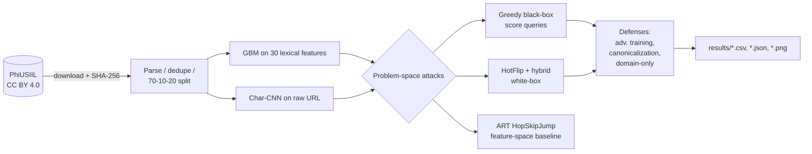

# Phishing Detector Adversarial Robustness

[](https://github.com/mikedsosa/phishing-detector-adversarial-robustness/actions/workflows/ci.yml)
[](LICENSE)


**How robust are URL-based phishing detectors to the cheap, realistic edits a phisher can actually make?**

This research project trains two URL-only phishing detectors on a public
dataset: a scikit-learn gradient-boosting model and a PyTorch character-level
CNN. It attacks them in the **problem space**, meaning every adversarial
example is a valid URL that the attacker could deploy without registering a
new domain. It then measures three defenses and what each one costs.

> **Background:** this project builds on my earlier university research
> interest in adversarial machine learning and phishing detection. It is a new,
> independent project using only public data.

📄 **Write-up:** [`docs/paper.md`](docs/paper.md) · 🎯 **Threat model:** [`docs/threat-model.md`](docs/threat-model.md) · 📊 **All results:** [`results/RESULTS.md`](results/RESULTS.md)

## Key findings

All numbers come from one run of `make reproduce` (seed 42) on the PhiUSIIL
dataset (235,370 unique URLs, CC BY 4.0). Attacks use 1,000 phishing test URLs
and a budget of at most 10 edits.

| | GBM (scikit-learn) | Char-CNN (PyTorch) |
|---|---|---|
| Clean test F1 | 0.9978 | 0.9980 |
| **Greedy black-box evasion rate** | **61.7%** | **61.6%** |
| Median edits per successful evasion | 1 | 1 |
| White-box hybrid evasion rate | – | 68.6% |
| Evasion after adversarial training | 32.7% (F1 0.9961) | 27.7% (F1 0.9969) |

*Evasion rate* is the share of phishing URLs that a model initially flags
(p ≥ 0.5) and that end below 0.5 after the attack. The scheme, `www`,
subdomain labels, path and query can change, but the registrable domain
cannot.

1. **Near-perfect accuracy is fragile.** About 6 in 10 detected phishing URLs
   slip through after cheap edits, most often just `http`→`https`.
2. **The benchmark has a shortcut.** 99.97% of PhiUSIIL's legitimate URLs are
   bare `https://www.<domain>` homepages. A one-line format rule scores
   **0.9948 F1**, within 0.003 of both learned models.
3. **Feature-space attacks mislead.** ART's HopSkipJump evades 100% of the time
   in feature space, but **0%** of its outputs correspond to any real URL.
4. **There is no free defense.** Adversarial training roughly halves evasion
   at a cost of less than 0.2 F1 points. Canonicalization and domain-only models
   are more robust, but clean F1 falls to 0.75–0.87.


## How it works



| Component | Where |
|---|---|
| URL parsing, validity constraints, canonicalization | `src/phishadv/urls.py` |
| Lexical features | `src/phishadv/features.py` |
| GBM and Char-CNN detectors | `src/phishadv/models.py` |
| Attacks (greedy, random, HotFlip, hybrid, append-only, shortener) | `src/phishadv/attacks.py` |
| ART HopSkipJump feature-space baseline | `src/phishadv/feature_space.py` |
| Experiment driver and report | `src/phishadv/experiment.py`, `src/phishadv/report.py` |

## Reproduce

```bash
python3.12 -m venv .venv && source .venv/bin/activate
make install      # pinned requirements (CPU PyTorch)
make reproduce    # downloads PhiUSIIL, verifies checksums, regenerates results/ (~20 min on 8 CPU cores)
```

Other targets:

```bash
make smoke        # ~15 s end-to-end run on the bundled 1,500-URL sample -> results-smoke/
make test         # pytest
make lint         # ruff
make scan         # gitleaks secret scan
```

To keep compute modest, models train on the full training split, but attacks
are subsampled: 1,000 test phishing URLs (HopSkipJump: 200), and adversarial
training uses 4,000 training phishing URLs per round. Seeds are fixed and
PyTorch deterministic mode is on. A second independent full run reproduced every metric exactly.

## Limitations

* Results describe detectors **trained on this benchmark**. Its legitimate
  URLs are homepages only, which inflates both clean accuracy and the
  effectiveness of "look like a homepage" edits.
* The main `owner` threat tier assumes the attacker runs the server and DNS.
  Under the conservative `append_only` tier (compromised sites), evasion is
  0.0–0.2%.
* Single seed, single dataset, random (not temporal) split, URL-only
  detectors. Sampling error is about ±3 percentage points.

See [`docs/paper.md` §5](docs/paper.md#5-limitations-and-honest-negatives) for
the full list.

## Data and ethics

The data is the [PhiUSIIL Phishing URL Dataset](https://archive.ics.uci.edu/dataset/967/phiusiil+phishing+url+dataset)
(Prasad & Chandra, 2024), used under CC BY 4.0. Raw data is not committed;
see [`data/README.md`](data/README.md). The attacks only rewrite strings
offline. No URL is ever resolved or visited, and example URLs in the results
are defanged. The CI sample in `tests/fixtures/` contains real phishing URLs,
so **don't visit them**.

## License

[MIT](LICENSE) © 2026 mikedsosa. Dataset © its creators, CC BY 4.0.
