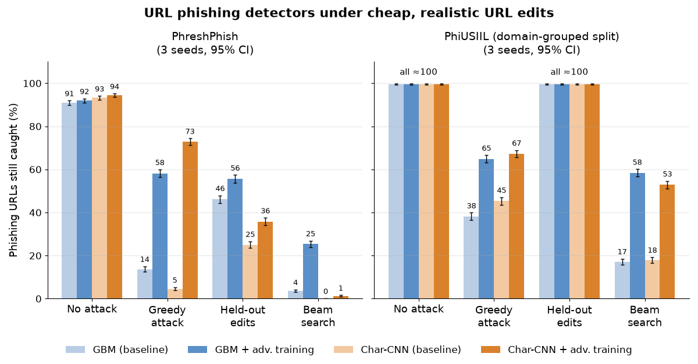
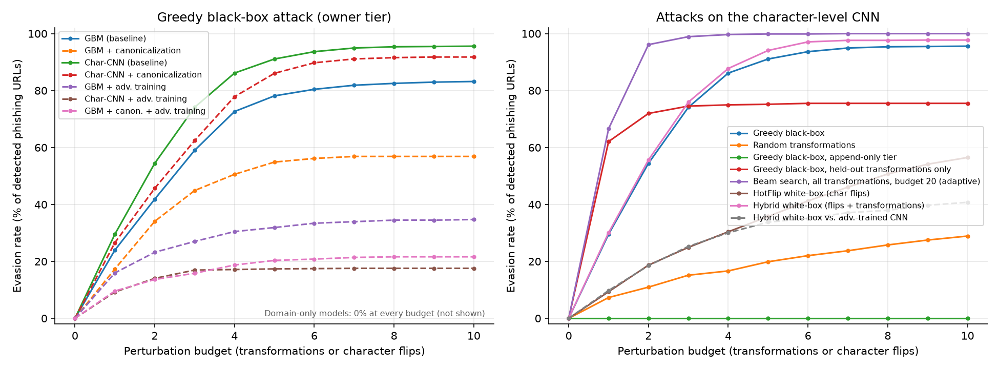
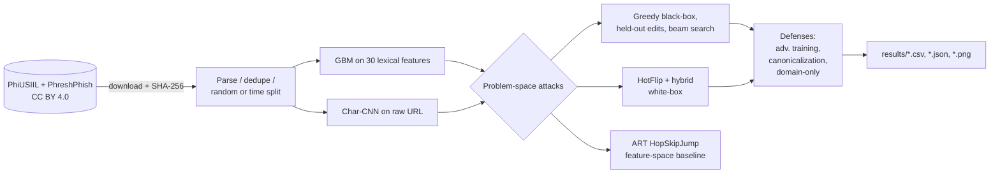

# Phishing Detector Adversarial Robustness

[](https://github.com/mikedsosa/phishing-detector-adversarial-robustness/actions/workflows/ci.yml)
[](LICENSE)


**How robust are URL-based phishing detectors to the cheap, realistic edits a phisher can actually make?**

This research project trains two URL-only phishing detectors, a scikit-learn
gradient-boosting model (GBM) and a PyTorch character-level CNN, and attacks
them in the **problem space**: every adversarial example passes our URL
validity and ownership checks (syntax, unchanged registrable domain). We don't
check that the rewritten page still serves. It then measures what several
defenses buy and cost, on two public datasets: PhiUSIIL and the newer,
time-split PhreshPhish.

> **Background:** this project builds on my earlier university research
> interest in adversarial machine learning and phishing detection. It is a new,
> independent project using only public data.

📄 **Paper:** [`docs/paper.md`](docs/paper.md) · ✍️ **Short write-up:** [`docs/writeup.md`](docs/writeup.md) · 🎯 **Threat model:** [`docs/threat-model.md`](docs/threat-model.md) · 🗂️ **Model card:** [`MODEL_CARD.md`](MODEL_CARD.md) · 📊 **Results:** [`results/SEEDS.md`](results/SEEDS.md), [`results/defenses/DEFENSES.md`](results/defenses/DEFENSES.md), [`results/drift/DRIFT.md`](results/drift/DRIFT.md), [`results/operating/`](results/operating/)



*Share of 1,000 sampled phishing test URLs per seed that each model flags and
still flags after the attack (same denominator for every model), pooled over
seeds 42–44, 95% Wilson intervals. Data: [`results/hero_data.csv`](results/hero_data.csv).*

## Quickstart (about 10 minutes, offline after install)

```bash
git clone https://github.com/mikedsosa/phishing-detector-adversarial-robustness.git
cd phishing-detector-adversarial-robustness
python3.12 -m venv .venv && source .venv/bin/activate   # or: uv venv -p 3.12 .venv
make install        # pinned requirements, CPU-only PyTorch
make test           # unit tests, including small end-to-end runs on the bundled samples
make demo-sample    # trains small models on the bundled PhiUSIIL sample and attacks one example URL
```

`make demo-sample` prints the model's score for an example URL and the
smallest set of edits that flips it, defanged. The full study needs the
datasets (`make data` downloads about 36 MB) and several CPU hours; see
[Reproduce](#reproduce).

## Threat model and limitations (short version)

* **The attacker owns their URL.** In the main `owner` tier the phisher runs
  the server and DNS for their domain, so they can change the scheme,
  subdomain labels, path, query and fragment, but not the registrable domain.
  Under a stricter `append_only` tier (roughly a compromised site),
  evasion stays at or below 1.2%. Attacks get unlimited score queries unless
  stated; query-budget and label-only results are [below](#attacker-knowledge-query-budgets-and-label-only-access).
* **URL-only detectors.** Real filters also use page content, hosting and
  reputation, so these are upper bounds for one layer, not for a mail or
  browser pipeline.
* **Dataset artifacts.** 99.97% of PhiUSIIL's legitimate URLs are bare
  `https://www.<domain>` homepages, and PhreshPhish stripped benign query
  strings for privacy. Both are shortcuts a model can learn. PhiUSIIL's random
  split also puts 38.6% of phishing test URLs on a registrable domain already
  seen in phishing training data (seed 42), so we add a **domain-grouped split**.
* **Seed instability.** On PhiUSIIL (random split) the baseline CNN's greedy
  evasion ranges from 50.6% to 63.0% across seeds 42–44. Three seeds show
  spread; they are not a variance study.
* **Defenses are upper bounds on robustness.** Adversarial training runs two
  rounds against hand-written edits; stronger or LLM-written rewrites could do
  better than our attacks.

Full details: [`docs/threat-model.md`](docs/threat-model.md) and
[`docs/paper.md` §5](docs/paper.md#5-limitations-and-honest-negatives).

## Key findings

Three seeds (42–44) per dataset unless stated. Brackets are 95% Wilson
intervals on evasions pooled over seeds.

1. **Fairer data made the detectors easier to evade, not harder.** Greedy
   black-box evasion with at most 10 edits is 63.5% (GBM) and 57.9% (CNN) on
   PhiUSIIL's random split, but 84.9% and 95.1% on PhreshPhish, usually within
   two edits.
2. **Adversarial training mostly teaches the model the attacker it saw.** On
   PhreshPhish it cuts greedy evasion to 36.7% (GBM) and 22.9% (CNN). Against
   edit types left out of training it helps less (39.5% and 62.1%), a wider
   beam search still gets through 72.5% and 98.7% of the time, and the
   false-positive rate goes up.
3. **Both benchmarks have shortcuts.** On PhiUSIIL a one-line "is it a bare
   `https://www.` homepage" rule scores 0.9948 F1. On PhreshPhish, benign
   URLs had their query strings stripped for privacy, so "has a query string"
   flags phishing with 99.7% precision.
4. **PhiUSIIL's random split leaks domains.** 38.6% of phishing test URLs
   (38.6–38.7% across seeds) share a registrable domain with a phishing
   training URL. <!-- ROUND2-GROUPED-FINDING -->
5. **Models don't carry over between datasets or months.** PhiUSIIL-trained
   models flag essentially all of PhreshPhish's legitimate URLs, and
   the PhreshPhish GBM's phishing recall falls from 95.9% on validation data to
   58.7% in the first month after its training data ends (seed 42).
6. **Stricter thresholds make evasion easier.** Tuning the PhreshPhish GBM to
   a 1% validation false-positive rate (seed 42) lets the greedy attack evade
   91.7% [89.7, 93.4] of flagged URLs, up from 83.2% at the default
   threshold.

## Results

### PhreshPhish (time split), seeds 42–44

Evasion rate = share of the phishing URLs a model flags at p ≥ 0.5 that the
attack pushes below 0.5. Cells: mean over seeds, pooled 95% Wilson interval
[brackets] and per-seed range. Denominators are the initially flagged URLs,
which differ by model (about 2,700–2,830 pooled), so compare with the
caught-under-attack figure above as well.

| | GBM | Char-CNN | GBM + adv. training | Char-CNN + adv. training |
|---|---|---|---|---|
| Clean test F1 | 0.931 (0.929–0.931) | 0.950 (0.947–0.951) | 0.932 (0.932–0.932) | 0.951 (0.949–0.955) |
| Clean test FPR | 3.06% (2.99–3.12) | 2.57% (2.21–3.13) | 3.86% (3.84–3.88) | 3.17% (2.35–4.80) |
| Greedy, ≤10 edits | 84.9% [83.5, 86.2] (83.2–86.1) | 95.1% [94.2, 95.8] (94.2–95.6) | 36.7% [35.0, 38.6] (34.7–40.0) | 22.9% [21.4, 24.4] (17.6–26.9) |
| Held-out edits, ≤10 | 49.3% [47.4, 51.2] (48.2–49.8) | 73.2% [71.5, 74.8] (69.3–75.5) | 39.5% [37.7, 41.4] (35.2–41.8) | 62.1% [60.3, 63.8] (55.1–66.8) |
| Beam search, all 19 edits, ≤20 | 96.1% [95.3, 96.7] (95.4–96.9) | 99.96% [99.8, 99.99] (99.9–100) | 72.5% [70.8, 74.1] (70.0–75.0) | 98.7% [98.2, 99.1] (97.6–99.4) |
| Random edits, label-only, ≤10 | 27.0% [25.4, 28.7] (26.0–28.9) | 25.9% [24.3, 27.6] (20.4–28.9) | 11.8% [10.6, 13.0] (10.7–13.6) | 7.9% [6.9, 8.9] (4.6–10.1) |

Adversarial training raises the false-positive rate: for the CNN from 2.2% to
4.8% on seed 42 (2.4–4.8% across seeds), for the GBM from 3.1% to 3.9%.

<!-- ROUND2-PHIUSIIL -->

### Drift

* **Over time (PhreshPhish, seed-42 models).** Training data runs to
  2025-09-08, testing from 2025-09-08 to 2025-12-16. Phishing detection drops
  from 95.9% (GBM) and 95.7% (CNN) on same-period validation rows to 58.7% and 85.0% on
  September 2025 test URLs, then recovers to 91–93% in October and November.
  False positives stay near 2–3% until December, when they rise to 8.4% (GBM)
  and 8.8% (CNN) on 1,017 benign URLs. Full table with CIs:
  [`results/drift/DRIFT.md`](results/drift/DRIFT.md).
* **Across datasets (all seeds).** PhiUSIIL-trained baselines flag 99.99–100%
  of PhreshPhish's legitimate URLs, and the PhreshPhish-trained GBM flags
  97.9–99.9% of PhiUSIIL's (the CNN 37.2–53.4%). Neither dataset alone
  predicts performance on the other.

### Low base rate and low false-positive thresholds (PhreshPhish, seed 42)

Real traffic is mostly benign. Reweighting the test set so phishing is 1% of
URLs, the baseline CNN's precision at 90% recall is 40.0% (GBM: 22.5%); at
0.05% it is 3.2% (GBM: 1.4%). Average precision falls from 0.92 to 0.39 (CNN)
between a 5% and a 0.05% base rate.

A lower threshold doesn't help against the attacks. Choosing the threshold on
validation data for at most 1% or 0.1% FPR and rerunning the attacks there
(95% Wilson intervals; denominators are the URLs flagged at that threshold):

| Model | Target val. FPR | Test FPR | Test recall | Greedy | Held-out | Beam |
|---|---|---|---|---|---|---|
| GBM | default (t = 0.5) | 3.06% | 89.9% | 83.2% [80.6, 85.5] | 48.2% [45.0, 51.5] | 95.9% [94.4, 97.0] |
| GBM | 1% | 1.16% | 85.3% | 91.7% [89.7, 93.4] | 51.4% [48.1, 54.7] | 98.2% [97.0, 98.9] |
| GBM | 0.1% | 0.12% | 72.7% | 99.2% [98.2, 99.6] | 76.3% [73.0, 79.2] | 99.9% [99.2, 100.0] |
| Char-CNN | default | 2.21% | 92.2% | 95.6% [94.1, 96.7] | 75.5% [72.6, 78.2] | 100.0% [99.6, 100.0] |
| Char-CNN | 0.1% | 0.15% | 70.3% | 98.4% [97.2, 99.1] | 74.1% [70.7, 77.2] | 100.0% [99.4, 100.0] |
| GBM + adv. training | 0.1% | 0.12% | 75.0% | 73.8% [70.6, 76.9] | 67.7% [64.3, 70.9] | 93.7% [91.8, 95.2] |
| Char-CNN + adv. training | 0.1% | 0.14% | 75.5% | 38.5% [35.1, 42.0] | 71.7% [68.4, 74.8] | 100.0% [99.5, 100.0] |

A strict threshold flags fewer phishing URLs to begin with, and the attacker
only has to push a score below a higher bar, so evasion goes up. Full tables:
[`results/operating/phreshphish/OPERATING.md`](results/operating/phreshphish/OPERATING.md).

### Attacker knowledge: query budgets and label-only access

The greedy attack needs few queries on PhreshPhish. With at most 50 score
queries per URL it already evades 81.7% (GBM, 79.2–83.5% across seeds) and
90.8% (CNN, 86.7–93.1%) of flagged URLs; with 10 queries, 17.0% and 18.1%.
An attacker who only sees the verdict, never the score, and applies random
valid edits until the URL passes still evades 27.0% (GBM) and 25.9% (CNN)
within 10 edits (table above). Per-budget curves: `evasion_vs_queries.csv` in
each results folder.

<!-- ROUND2-DEFENSES -->

### Other findings carried over from round 1

* **Feature-space attacks mislead.** ART's HopSkipJump "evades" almost every
  time in feature space, but only 0% (PhiUSIIL) and 6% (PhreshPhish) of its
  outputs map to a realizable URL (seed 42, 200 URLs).
* **Domain-only models** can't be evaded by the edits in our threat model
  but reach only 0.75–0.86 F1. Wrapping the URL in a link shortener, which is
  outside the threat model, still evades the domain-only GBM about 24% of the
  time.
* **Canonicalization** (stripping attacker-controlled formatting before
  scoring) helps the PhreshPhish GBM (greedy 83.2% → 56.9%, seed 42) far more
  than the CNN. We did not build an attack aimed specifically at it.



## How it works



| Component | Where |
|---|---|
| URL parsing, validity constraints, canonicalization | `src/phishadv/urls.py` |
| Lexical features | `src/phishadv/features.py` |
| GBM and Char-CNN detectors | `src/phishadv/models.py` |
| Attacks (greedy, held-out, beam, random, HotFlip, hybrid, append-only, shortener) | `src/phishadv/attacks.py` |
| ART HopSkipJump feature-space baseline | `src/phishadv/feature_space.py` |
| Experiment driver, report, cross-seed aggregation | `src/phishadv/experiment.py`, `report.py`, `aggregate.py` |
| Single-URL demo CLI and local Streamlit app | `src/phishadv/cli.py`, `app/streamlit_app.py` |

## Reproduce

```bash
python3.12 -m venv .venv && source .venv/bin/activate
make install      # pinned requirements (CPU PyTorch)
make reproduce    # downloads both datasets, verifies checksums, runs seeds 42-44 on both, aggregates (about 3 h on 8 CPU cores; each of the six runs takes 28–31 min)
```

Round 2 (domain-grouped PhiUSIIL split, new defenses, drift, operating
points; several more CPU hours):

```bash
make round2       # grouped PhiUSIIL seeds 42-44, defense runs on both datasets, then aggregate, drift, operating, defense_report
```

`make reproduce` runs `reproduce-main` (seed 42 on both datasets, which also
saves the demo models to `models/`), then `seeds` (43 and 44), then
`aggregate`. Other targets:

```bash
make smoke        # fast end-to-end runs on the bundled samples -> results-smoke/
make test         # pytest
make lint         # ruff
make scan         # gitleaks secret scan
make models       # train and save the demo models only
```

To keep compute modest, models train on the full training split (PhreshPhish:
a fixed 164,759-URL subsample of it), but attacks are subsampled: 1,000 test
phishing URLs (HopSkipJump: 200), and adversarial training uses 4,000
training phishing URLs per round. Seeds are fixed and PyTorch deterministic
mode is on.

## Demo (local only)

The CLI scores **one** URL and searches for the smallest set of edits that
flips the verdict. There is no batch mode on purpose. Every URL it prints is
defanged (`hxxp`, `[.]`), and it never resolves or visits anything.

```bash
make models                                   # or make reproduce-main
make demo URL='http://secure-login.example-account.xyz/verify.php?id=1'
pip install -r requirements-demo.txt && make app   # Streamlit on localhost:8501
```

The demo is not deployed anywhere.

## Docker

```bash
docker build -t phishadv . && docker run --rm phishadv
```

The image runs the unit tests and the smoke test, then trains small models on
the bundled sample and scores one example URL.
Docker itself wasn't available where this was developed. The image was built
with rootless podman, using a copy of the Dockerfile without `--chown` and
`USER` (the build sandbox couldn't change file owners). A full container run
hasn't been completed yet, so treat the Dockerfile as lightly tested.

## Limitations and future work

* URL-only detectors. Real filters also see page content, hosting and
  reputation signals, so these evasion rates are an upper bound for a
  URL-only layer, not for a full email or browser pipeline.
* Both benchmarks have collection artifacts (homepage-only benign URLs in
  PhiUSIIL; stripped benign query strings in PhreshPhish) that the models can
  exploit. The `format_rule` and `query_rule` baselines make them visible.
* PhiUSIIL's random split puts many same-domain phishing URLs in both train
  and test. Round-1 PhiUSIIL numbers use that split; the domain-grouped
  numbers above are the ones to compare against.
* The main `owner` threat tier assumes the attacker runs the server and DNS.
  Under the conservative `append_only` tier (compromised sites), evasion is
  at most 1.2%. Validity is checked syntactically: we do not check that a
  rewritten URL still serves the phishing page.
* Attacks get unlimited score queries unless stated. The label-only attack
  is a simple random search, not a state-of-the-art decision-based attack.
* Three seeds (42–44) per dataset: enough to show run-to-run spread, not a
  variance study. Some round-2 analyses use seed 42 only and say so.
* Adversarial training and the round-2 defenses are evaluated against our
  own hand-written attacks, so their robustness is an upper bound.

**Future work:** URLNet- and transformer-based detectors; an adaptive
attack aimed at canonicalization; LLM-written URL rewrites; the gray-box
defense of Apruzzese & Subrahmanian (paper ref. [17]); checking that
rewritten URLs still resolve to the same content.

See [`docs/paper.md` §5](docs/paper.md#5-limitations-and-honest-negatives) and
[`MODEL_CARD.md`](MODEL_CARD.md) for the full list.

## Data and ethics

| Dataset | Source | License | Split |
|---|---|---|---|
| PhiUSIIL (Prasad & Chandra, 2024) | [UCI](https://archive.ics.uci.edu/dataset/967/phiusiil+phishing+url+dataset) | CC BY 4.0 | random 70/10/20, and 70/10/20 grouped by registrable domain (round 2) |
| PhreshPhish v1.0.1 (Dalton et al., 2025) | [Hugging Face](https://huggingface.co/datasets/phreshphish/phreshphish) | CC BY 4.0 (authors ask that it be used for anti-phishing research) | the dataset's own time split |

Raw data is not committed. `make data` downloads only the dataset files (for
PhreshPhish, just the URL and label columns via HTTP range requests) and
checks SHA-256 hashes; see [`data/README.md`](data/README.md). The attacks
only rewrite strings offline. No URL is ever resolved or visited, and example
URLs in the results are defanged. The CI samples in `tests/fixtures/`
contain real phishing URLs, so **don't visit them**.

## License

[MIT](LICENSE) © 2026 mikedsosa. Datasets © their creators, CC BY 4.0.
