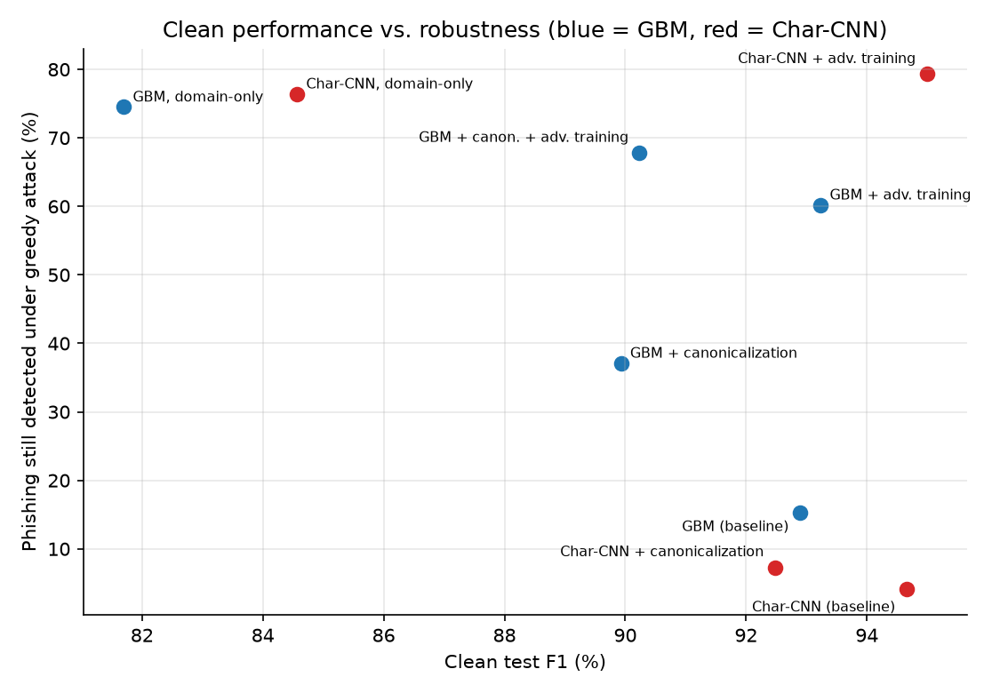
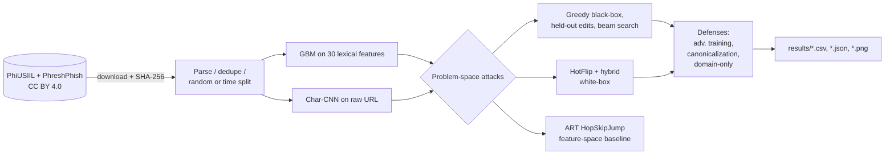

# Phishing Detector Adversarial Robustness

[](https://github.com/mikedsosa/phishing-detector-adversarial-robustness/actions/workflows/ci.yml)
[](LICENSE)


**How robust are URL-based phishing detectors to the cheap, realistic edits a phisher can actually make?**

This research project trains two URL-only phishing detectors: a scikit-learn
gradient-boosting model and a PyTorch character-level CNN. It attacks them in
the **problem space**, meaning every adversarial example is a valid URL the
attacker could deploy without registering a new domain. It then measures
three defenses and what each one costs. Everything runs on two public
datasets: PhiUSIIL and the newer, time-split PhreshPhish.

> **Background:** this project builds on my earlier university research
> interest in adversarial machine learning and phishing detection. It is a new,
> independent project using only public data.

📄 **Paper:** [`docs/paper.md`](docs/paper.md) · ✍️ **Short write-up:** [`docs/writeup.md`](docs/writeup.md) · 🎯 **Threat model:** [`docs/threat-model.md`](docs/threat-model.md) · 🗂️ **Model card:** [`MODEL_CARD.md`](MODEL_CARD.md) · 📊 **Results:** [`results/phreshphish/RESULTS.md`](results/phreshphish/RESULTS.md), [`results/RESULTS.md`](results/RESULTS.md), [`results/SEEDS.md`](results/SEEDS.md)

## Key findings

Headline numbers are from the seed-42 run on **PhreshPhish** (CC BY 4.0;
real benign browsing URLs, test set collected after the training set). The
attacks use 1,000 phishing test URLs. Brackets are 95% Wilson intervals.
A second PhreshPhish seed (43) is in [`results/SEEDS.md`](results/SEEDS.md):
the baseline rates move by at most 2.9 points, the adversarially trained CNN's
by up to 9.4. The remaining seed runs (PhiUSIIL 43/44, PhreshPhish 44) had
not finished when these results were committed; `make seeds` runs them.

| | GBM (scikit-learn) | Char-CNN (PyTorch) |
|---|---|---|
| Clean test F1 (FPR) | 0.929 (3.1%) | 0.947 (2.2%) |
| **Greedy black-box evasion, ≤10 edits** | **83.2%** [80.6, 85.5] | **95.6%** [94.1, 96.7] |
| Held-out edits (never used in training), ≤10 | 48.2% [45.0, 51.5] | 75.5% |
| Beam search, 19 edit types, ≤20 | 95.9% [94.4, 97.0] | 100% |
| After adversarial training: greedy | 34.7% [31.7, 37.8] | 17.6% [15.3, 20.1] |
| After adversarial training: held-out | 35.2% [32.2, 38.4] | 55.1% [51.9, 58.2] |
| After adversarial training: beam | 70.0% [66.9, 72.8] | 97.6% [96.4, 98.4] |

*Evasion rate* is the share of phishing URLs that a model initially flags
(p ≥ 0.5) and that end below 0.5 after the attack. The scheme, `www`,
subdomain labels, path and query can change, but the registrable domain
cannot.

1. **Fairer data made the detectors easier to evade, not harder.** On
   PhiUSIIL about 62% of detected phishing URLs evaded both models. On
   PhreshPhish it is 83% (GBM) and 96% (CNN), usually within two edits.
2. **Adversarial training mostly teaches the model the attacker it saw.** It
   cuts greedy evasion to 35% and 18%. Against edit types left out of training
   it helps much less, and a wider beam search still gets through 70% (GBM)
   and 98% (CNN) of the time.
3. **Both benchmarks have shortcuts.** On PhiUSIIL a one-line "is it a bare
   `https://www.` homepage" rule scores 0.9948 F1. On PhreshPhish, benign
   URLs had their query strings stripped for privacy, so "has a query string"
   flags phishing with 99.7% precision.
4. **Models don't carry over between datasets.** The PhreshPhish-trained GBM
   flags 99.9% of PhiUSIIL's legitimate homepages as phishing, and the
   PhiUSIIL-trained full-URL models flag 93–100% of PhreshPhish's legitimate
   URLs.
5. **Feature-space attacks mislead.** ART's HopSkipJump "evades" almost every
   time in feature space, but only 0% (PhiUSIIL) and 6% (PhreshPhish) of its
   outputs map to a realizable URL.




### PhiUSIIL (original benchmark)

| | GBM | Char-CNN |
|---|---|---|
| Clean test F1 | 0.9978 | 0.9980 |
| Greedy black-box evasion | 61.7% [58.6, 64.7] | 63.0% [59.9, 65.9] |
| Held-out edits | 0.2% | 0.0% |
| Beam search, 19 edit types, ≤20 | 77.4% | 84.4% |
| White-box hybrid evasion | – | 71.0% |
| After adversarial training: greedy | 32.7% | 28.9% |
| After adversarial training: beam | 38.3% | 37.4% |

Held-out edits barely work here because they all move a URL away from the
bare-homepage look that PhiUSIIL's models treat as legitimate. PhiUSIIL-trained
models that see the full URL flag 93–100% of PhreshPhish's legitimate URLs.

Full tables, including held-out and beam attacks on PhiUSIIL, are in
[`results/RESULTS.md`](results/RESULTS.md).

## How it works



| Component | Where |
|---|---|
| URL parsing, validity constraints, canonicalization | `src/phishadv/urls.py` |
| Lexical features | `src/phishadv/features.py` |
| GBM and Char-CNN detectors | `src/phishadv/models.py` |
| Attacks (greedy, held-out, beam, random, HotFlip, hybrid, append-only, shortener) | `src/phishadv/attacks.py` |
| ART HopSkipJump feature-space baseline | `src/phishadv/feature_space.py` |
| Experiment driver, report, cross-seed aggregation | `src/phishadv/experiment.py`, `report.py`, `aggregate.py` |
| Single-URL demo CLI and local Streamlit app | `src/phishadv/cli.py`, `app/streamlit_app.py` |

## Reproduce

```bash
python3.12 -m venv .venv && source .venv/bin/activate
make install      # pinned requirements (CPU PyTorch)
make reproduce    # downloads both datasets, verifies checksums, runs seeds 42-44 on both, aggregates (about 3 h on 8 CPU cores; each of the six runs takes about 28 min)
```

`make reproduce` runs `reproduce-main` (seed 42 on both datasets, which also
saves the demo models to `models/`), then `seeds` (43 and 44), then
`aggregate`. Other targets:

```bash
make smoke        # fast end-to-end runs on the bundled samples -> results-smoke/
make test         # pytest
make lint         # ruff
make scan         # gitleaks secret scan
make models       # train and save the demo models only
```

To keep compute modest, models train on the full training split (PhreshPhish:
a fixed 164,759-URL subsample of it), but attacks are subsampled: 1,000 test
phishing URLs (HopSkipJump: 200), and adversarial training uses 4,000
training phishing URLs per round. Seeds are fixed and PyTorch deterministic
mode is on.

## Demo (local only)

The CLI scores **one** URL and searches for the smallest set of edits that
flips the verdict. There is no batch mode on purpose. Every URL it prints is
defanged (`hxxp`, `[.]`), and it never resolves or visits anything.

```bash
make models                                   # or make reproduce-main
make demo URL='http://secure-login.example-account.xyz/verify.php?id=1'
pip install -r requirements-demo.txt && make app   # Streamlit on localhost:8501
```

The demo is not deployed anywhere.

## Docker

```bash
docker build -t phishadv . && docker run --rm phishadv
```

The image runs the unit tests and the smoke test, then trains small models on
the bundled sample and scores one example URL.
Docker itself wasn't available where this was developed. The image was built
with rootless podman, using a copy of the Dockerfile without `--chown` and
`USER` (the build sandbox couldn't change file owners). A full container run
hasn't been completed yet, so treat the Dockerfile as lightly tested.

## Limitations

* URL-only detectors. Real filters also see page content, hosting and
  reputation signals, so these evasion rates are an upper bound for a
  URL-only layer, not for a full email or browser pipeline.
* Both benchmarks have collection artifacts (homepage-only benign URLs in
  PhiUSIIL; stripped benign query strings in PhreshPhish) that the models can
  exploit. The `format_rule` and `query_rule` baselines make them visible.
* The main `owner` threat tier assumes the attacker runs the server and DNS.
  Under the conservative `append_only` tier (compromised sites), evasion is
  at most 1.2%.
* Two seeds on PhreshPhish, one on PhiUSIIL so far. The transformations are hand-written; LLM-written
  rewrites are left as future work.

See [`docs/paper.md` §5](docs/paper.md#5-limitations-and-honest-negatives) and
[`MODEL_CARD.md`](MODEL_CARD.md) for the full list.

## Data and ethics

| Dataset | Source | License | Split |
|---|---|---|---|
| PhiUSIIL (Prasad & Chandra, 2024) | [UCI](https://archive.ics.uci.edu/dataset/967/phiusiil+phishing+url+dataset) | CC BY 4.0 | random 70/10/20 |
| PhreshPhish v1.0.1 (Dalton et al., 2025) | [Hugging Face](https://huggingface.co/datasets/phreshphish/phreshphish) | CC BY 4.0 (authors ask that it be used for anti-phishing research) | the dataset's own time split |

Raw data is not committed. `make data` downloads only the dataset files (for
PhreshPhish, just the URL and label columns via HTTP range requests) and
checks SHA-256 hashes; see [`data/README.md`](data/README.md). The attacks
only rewrite strings offline. No URL is ever resolved or visited, and example
URLs in the results are defanged. The CI samples in `tests/fixtures/`
contain real phishing URLs, so **don't visit them**.

## License

[MIT](LICENSE) © 2026 mikedsosa. Datasets © their creators, CC BY 4.0.
