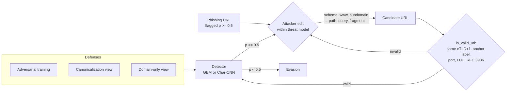
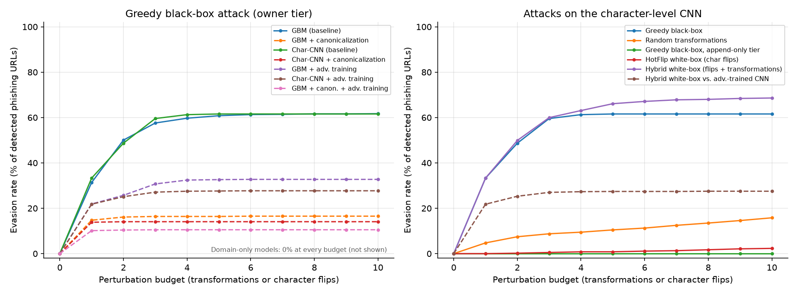
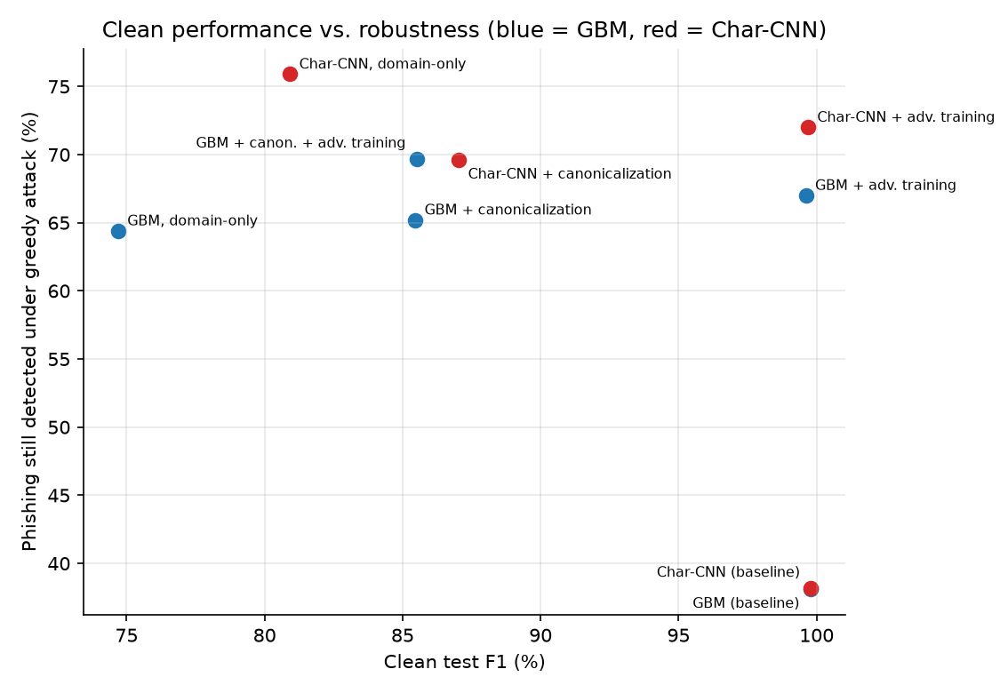

# Cheap Edits, Big Drops: Problem-Space Evasion of URL-Based Phishing Detectors

*mikedsosa. Independent research project, 2026. Code, data pipeline and every
number in this document are at
<https://github.com/mikedsosa/phishing-detector-adversarial-robustness>.
All results come from one run of `make reproduce` (config `full`, seed 42).
They are copied from [`results/RESULTS.md`](../results/RESULTS.md) and
[`results/summary.json`](../results/summary.json), with no rounding beyond
the stated precision.*

## Abstract

URL-only phishing detectors look near-perfect on public benchmarks. We ask how
much of that accuracy survives an attacker who makes only changes they could
really make to a live phishing URL: switching to HTTPS, adding or removing
`www`, renaming paths, and similar edits. Two baselines are trained on the
CC BY 4.0 PhiUSIIL dataset (235,370 unique URLs): a scikit-learn gradient-boosted
model on 30 lexical features and a character-level CNN. Both reach about 0.998
F1 on a held-out test set. A greedy black-box attack limited to at most 10 such
edits, all keeping the registrable domain fixed, evades **61.7%** (GBM) and
**61.6%** (CNN) of the phishing URLs each model initially detects. Most
evasions take **one** edit, usually `http`→`https`. A white-box hybrid attack
on the CNN reaches **68.6%**. We trace this to a dataset artifact: **99.97% of
legitimate URLs in PhiUSIIL have the form `https://www.<domain>`**, and a
one-line format rule alone scores 0.9948 F1. We evaluate three defenses.
Adversarial training roughly halves evasion (GBM 32.7%, CNN 27.7%) at a cost
of less than 0.2 F1 points. Canonicalization (removing attacker-free URL
components) cuts evasion to 14–17%, but clean F1 falls to 0.85–0.87. A
domain-only model cannot be evaded within the threat model at all, but its
clean F1 is only 0.75–0.81. An unconstrained feature-space attack (ART
HopSkipJump) "succeeds" 100% of the time, yet **0%** of its outputs
correspond to any real URL. This reinforces that robustness claims for
security ML must be made in the problem space.

## 1. Background and related work

**Adversarial examples and evasion.** Biggio et al. [1] showed that
gradient-based evasion attacks at test time can defeat classifiers in
security settings such as PDF-malware detection. Goodfellow et al. [2]
popularized fast gradient attacks and adversarial training for neural
networks, and Madry et al. [3] framed adversarial training as robust
optimization against a defined threat model. For text, HotFlip [4] uses
gradients with respect to one-hot inputs to choose character flips for
character-level classifiers. Our white-box attack adapts that idea to URLs.

**Problem space vs. feature space.** Pierazzi et al. [5] formalized
*problem-space* attacks. These must produce real objects that respect the
domain's constraints (available transformations, preserved semantics,
plausibility), not just feature vectors that cross a decision boundary.
Apruzzese et al. [6] argue that real attackers rarely compute gradients and
instead use cheap, domain-specific tricks. For phishing specifically,
SpacePhish [7] contrasts feature-space and problem-space evasion of ML
phishing-website detectors. Earlier work studied adversarial sampling against
phishing classifiers [8] and adversarial attacks on URL-based phishing
detectors [9].

**URL-based detection.** Lexical-feature models and character-level CNNs are
standard URL-only baselines. URLNet [10] combines character- and word-level
CNNs over raw URLs, and our CNN is a simpler character-only variant. PhiUSIIL
[11] is a recent large dataset of phishing and legitimate URLs released under
CC BY 4.0.

**Tooling.** We use the Adversarial Robustness Toolbox (ART) [12] to run
HopSkipJump [13], a decision-based attack, as an unconstrained feature-space
baseline.

## 2. Threat model

The full threat model is in [`threat-model.md`](threat-model.md). In short:

* **System:** a URL-only classifier (no page fetch), as in mail or chat link
  scanning, outputting P(phishing). A URL is blocked at P ≥ 0.5.
* **Attacker goal:** evasion. A phishing URL the detector currently flags
  should be scored < 0.5 while still serving the same phishing kit.
* **Knowledge:** black-box with scores (main attack), black-box with random
  choice (weak baseline), and white-box with gradients (CNN only).
* **Capabilities (`owner` tier):** the attacker runs the phishing server and
  DNS, so they may change the scheme, subdomain labels left of the anchor
  label, the path, the query and the fragment. The **registrable domain
  (eTLD+1, including the Public Suffix List's private section), the anchor
  label (the rightmost non-`www` subdomain label) and the port are fixed.**
  Every candidate must be a syntactically valid URL (LDH host labels, ASCII,
  RFC 3986 characters).
* **`append_only` tier:** for compromised or shared hosts, the attacker can only
  append an unused query parameter or a fragment.
* **Budget:** at most 10 perturbations, where one perturbation is one
  transformation or one character flip.
* **Out of scope:** registering new domains, open redirects and link
  shorteners. A shortener wrap is reported separately for context.

## 3. Method

### 3.1 Data

PhiUSIIL [11] (UCI dataset 967, CC BY 4.0) is downloaded by
`scripts/download_data.py`, which verifies SHA-256 checksums for the zip and
the CSV. We use only the raw `URL` and `label` columns. Labels are flipped so
that phishing = 1, IDNA labels are converted to A-labels, and duplicates and
conflicting duplicates are dropped. That leaves **235,370 unique URLs (42.7%
phishing)**, split 70/10/20 into train (164,759), validation (23,537) and test
(47,074), stratified, seed 42.

**Dataset structure (all unique URLs):**

| Class | n | https | leading www | non-root path | query | bare `https://www.<domain>` |
|---|---|---|---|---|---|---|
| legitimate | 134,850 | 1.0000 | 0.9997 | 0.0000 | 0.0000 | 0.9997 |
| phishing | 100,520 | 0.4863 | 0.4111 | 0.2714 | 0.0604 | 0.0105 |

Legitimate URLs in PhiUSIIL are homepages collected as `https://www.<domain>`.
A detector can therefore separate the classes largely by URL *format*. We
include a non-learned **format rule** baseline: flag as phishing any URL that
is not of the form `https://www.<domain>`.

### 3.2 Detectors

* **GBM:** scikit-learn `HistGradientBoostingClassifier` (300 iterations,
  63 leaves) on 30 lexical features (lengths, character counts, entropy, IP
  host, suspicious tokens, confusable/punycode flags, and so on) plus a one-hot
  encoding of the 30 most frequent public suffixes.
* **Char-CNN:** PyTorch. Character embedding (dim 32, max length 200),
  parallel 1-D convolutions of width 3, 5 and 7 (128 filters each), masked
  max-pooling and a linear head. 3 epochs, batch 256, Adam at learning rate
  1e-3.

Each detector can read one of three *views* of the URL:
`raw`; `canon` (decode IDNA and map confusables to ASCII, force the scheme to
`http`, strip a leading `www`, trailing `/` and the fragment); and `domain`
(`http://<registrable domain>` only).

### 3.3 Attacks (all problem-space unless noted)

* **Greedy black-box (score-based):** at each step, generate every valid
  neighbor of the current URL under the threat-model transformations, query
  the detector on all of them, and move to the lowest-scoring one. Stop at
  p < 0.5, at the budget, or at a local optimum. Queries are counted.
* **Random black-box:** apply random valid transformations, up to the budget.
* **Greedy, append-only tier:** greedy, restricted to appending a query
  parameter or a fragment.
* **HotFlip white-box (CNN):** first-order estimate of the logit change for
  each allowed character substitution, as in [4]. The top 16 candidates are
  verified exactly and the best is applied. Substitutions are limited to
  alphanumeric characters in non-anchor subdomain labels and the
  path/query/fragment. The attack may first add one attacker-owned subdomain
  label or path segment, which costs one perturbation.
* **Hybrid white-box (CNN):** each step chooses the best of the HotFlip
  candidates and all structural transformations, scored exactly with the
  white-box model.
* **Link-shortener wrap (out of scope):** replace the URL with a plausible
  shortener URL. One step, reported for context.
* **HopSkipJump (feature space, GBM):** ART's `HopSkipJump` [12, 13] on the
  GBM's feature vectors, seeded with the nearest legitimate training vector.
  200 URLs, 20 iterations. We then check whether each adversarial vector is
  *realizable*: integer and binary features must stay consistent in type, and
  features tied to the registrable domain must not change.

### 3.4 Defenses

1. **Adversarial training (AT):** 2 rounds. In each round we attack 4,000
   randomly chosen training phishing URLs with the greedy attack, add every
   intermediate and final URL from the attack trajectories (labelled
   phishing) to the training set, and retrain from scratch. For the CNN we
   also add hybrid white-box examples for half of the sampled URLs.
   Variants: `gbm_raw_at`, `cnn_raw_at` and `gbm_canon_at`.
2. **Canonicalization:** train and test on the `canon` view, which removes
   features the attacker controls for free.
3. **Domain-only:** train and test on the registrable domain only. This is
   robust *by construction* under our threat model, because nothing the
   attacker may change reaches the model.

### 3.5 Metrics

* **Evasion rate:** among phishing URLs in the attack sample that the model
  flags before the attack (p ≥ 0.5), the fraction whose final adversarial URL
  scores p < 0.5 within the budget.
* **Detection under attack:** the fraction of *all* sampled phishing URLs that
  are still flagged after the attack. This is the fair metric across models
  with different clean recall.
* **Attack sample:** 1,000 phishing URLs drawn at random from the test set
  (seed 42). The same sample is used for every model.

**Compute:** one run takes 1,191 s on an 8-core CPU (no GPU). Models train
on the full training split. Attacks are subsampled to 1,000 test phishing
URLs and HopSkipJump to 200, and adversarial training uses 4,000 training
phishing URLs per round. These subsampling choices are what keep the run
modest.

## 4. Results

### 4.1 Clean performance (test set, n = 47,074)

| Model | Accuracy | Precision | Recall | F1 | ROC-AUC | FPR |
|---|---|---|---|---|---|---|
| GBM (baseline) | 0.9981 | 0.9995 | 0.9961 | 0.9978 | 0.9984 | 0.0004 |
| Char-CNN (baseline) | 0.9983 | 1.0000 | 0.9960 | 0.9980 | 0.9989 | 0.0000 |
| **Format rule** (not `https://www.<domain>`) | 0.9956 | 0.9998 | 0.9899 | 0.9948 | 0.9949 | 0.0001 |
| GBM + adv. training | 0.9967 | 0.9954 | 0.9969 | 0.9961 | 0.9990 | 0.0034 |
| Char-CNN + adv. training | 0.9973 | 0.9967 | 0.9971 | 0.9969 | 0.9993 | 0.0025 |
| GBM + canonicalization | 0.8882 | 0.9613 | 0.7692 | 0.8546 | 0.9204 | 0.0231 |
| Char-CNN + canonicalization | 0.8984 | 0.9566 | 0.7984 | 0.8704 | 0.9372 | 0.0270 |
| GBM + canon. + adv. training | 0.8885 | 0.9612 | 0.7701 | 0.8551 | 0.9203 | 0.0232 |
| GBM, domain-only | 0.8137 | 0.8895 | 0.6438 | 0.7469 | 0.8679 | 0.0596 |
| Char-CNN, domain-only | 0.8515 | 0.8968 | 0.7372 | 0.8092 | 0.9073 | 0.0633 |

The format rule comes within 0.003 F1 of both learned models. Removing format
cues (canonicalization) costs about 0.13–0.14 F1. That gap is roughly how much
of the "near-perfect" accuracy depends on a dataset artifact rather than on
signals that generalize.

### 4.2 Robustness (1,000 phishing test URLs, budget 10)

| Model | Attack | Detected before | Evasion rate | Detection under attack | Median steps |
|---|---|---|---|---|---|
| GBM (baseline) | Greedy black-box | 995 | **0.617** | 0.381 | 1 |
| GBM (baseline) | Random | 995 | 0.154 | 0.842 | 3 |
| GBM (baseline) | Greedy, append-only | 995 | 0.002 | 0.993 | 1 |
| Char-CNN (baseline) | Greedy black-box | 994 | **0.616** | 0.382 | 1 |
| Char-CNN (baseline) | Random | 994 | 0.158 | 0.837 | 3 |
| Char-CNN (baseline) | Greedy, append-only | 994 | 0.000 | 0.994 | – |
| Char-CNN (baseline) | HotFlip white-box | 994 | 0.023 | 0.971 | 7 |
| Char-CNN (baseline) | **Hybrid white-box** | 994 | **0.686** | 0.312 | 2 |
| GBM + adv. training | Greedy black-box | 996 | 0.327 | 0.670 | 1 |
| Char-CNN + adv. training | Greedy black-box | 996 | 0.277 | 0.720 | 1 |
| Char-CNN + adv. training | HotFlip white-box | 996 | 0.003 | 0.993 | 5 |
| Char-CNN + adv. training | Hybrid white-box | 996 | 0.275 | 0.722 | 1 |
| GBM + canonicalization | Greedy black-box | 781 | 0.165 | 0.652 | 1 |
| Char-CNN + canonicalization | Greedy black-box | 810 | 0.141 | 0.696 | 1 |
| GBM + canon. + adv. training | Greedy black-box | 779 | 0.105 | 0.697 | 1 |
| GBM, domain-only | Greedy black-box | 644 | 0.000 | 0.644 | – |
| Char-CNN, domain-only | Greedy black-box | 759 | 0.000 | 0.759 | – |
| GBM, domain-only | Shortener wrap (out of scope) | 644 | 0.239 | 0.490 | 1 |
| GBM (baseline) | Shortener wrap (out of scope) | 995 | 0.000 | 0.995 | – |

The full table, covering every model × attack pair, is in
[`results/RESULTS.md`](../results/RESULTS.md).

**Query efficiency (greedy, baseline models):** within 10 queries the attack
already evades 31.7% (GBM) and 33.8% (CNN) of detected phishing URLs. Within
50 queries it evades 60.6% and 61.4%, and it plateaus at 61.7% and 61.6% by
100 queries (`results/evasion_vs_queries.csv`).

**What the attack changes:** across successful greedy attacks on the GBM, the
transformations used were scheme→https (374), path edits (369), subdomain
edits (338) and query/fragment edits (30). For the CNN they were path (376),
scheme (366), subdomain (288) and query/fragment (14). One attack can use
several kinds. The attack mostly makes phishing URLs *look like* the
dataset's legitimate format.

**Transfer:** greedy adversarial URLs crafted against one baseline transfer
almost completely to the other. CNN→GBM evasion is 0.908 (n = 612) and
GBM→CNN is 0.888 (n = 614). They transfer much less to defended models:
0.316–0.515 depending on the target.

**Feature space vs. problem space:** HopSkipJump on the GBM's feature vectors
reaches **100% evasion** (200/200), with a median of 50 features changed and a
median normalized L2 distance of 0.823. But **0%** of its adversarial vectors
are type-consistent, **100%** change features tied to the fixed registrable
domain, and so **0%** are realizable as URLs under the threat model.

### 4.3 Defense tradeoffs

| Defense | Clean F1 (GBM / CNN) | Greedy evasion (GBM / CNN) | Detection under greedy attack (GBM / CNN) |
|---|---|---|---|
| None | 0.9978 / 0.9980 | 0.617 / 0.616 | 0.381 / 0.382 |
| Adversarial training | 0.9961 / 0.9969 | 0.327 / 0.277 | 0.670 / 0.720 |
| Canonicalization | 0.8546 / 0.8704 | 0.165 / 0.141 | 0.652 / 0.696 |
| Canon. + adv. training (GBM) | 0.8551 / – | 0.105 / – | 0.697 / – |
| Domain-only | 0.7469 / 0.8092 | 0.000 / 0.000 | 0.644 / 0.759 |

* **Adversarial training** gives the best balance. Clean F1 drops by 0.0017
  (GBM) and 0.0011 (CNN), FPR rises from 0.0004 to 0.0034 (GBM) and from 0 to
  0.0025 (CNN), and detection under attack rises from about 38% to 67–72%. It
  also cuts hybrid white-box evasion on the CNN from 0.686 to 0.275. It does
  **not** close the gap: about 28–33% of detected phishing URLs are still
  evaded with typically one edit.
* **Canonicalization** removes the cheapest shortcut, but it also removes the
  signal the models had leaned on, so clean recall falls to 0.77–0.80 and FPR
  rises to 2.3–2.7%. Under attack it detects about as much as adversarial
  training (65–70%), but with much worse clean performance.
* **Domain-only** is unevadable *within* our threat model by construction.
  Its clean recall (0.64–0.74) and FPR (about 6%) make it unusable alone, and
  an out-of-scope link shortener evades 23.9% of the GBM domain model's
  detections in one step.

## 5. Limitations and honest negatives

* **The headline vulnerability is partly a dataset artifact.** Legitimate
  URLs in PhiUSIIL are almost all bare `https://www.<domain>` homepages, so
  "switch to HTTPS and add `www`" is a strong evasion here. Real legitimate
  traffic includes deep links, query strings and plain-HTTP sites, so the
  same attack may be far weaker against a detector trained on more
  representative benign data. Our numbers measure robustness *of detectors
  trained on this benchmark*, not of production systems.
* **The `owner` tier is an upper bound and `append_only` is a lower bound.**
  We can't tell which phishing URLs are on attacker-owned infrastructure and
  which are on compromised sites. Under the conservative append-only tier,
  evasion is 0.000–0.002 for every model. The large numbers depend on the
  attacker controlling the server and DNS.
* **Pure character-flip HotFlip is weak** (0.023 on the baseline CNN). Our
  white-box attack is first-order and greedy with no beam search, so this is
  a weak upper bound on character-level vulnerability. Most white-box success
  comes from structural edits.
* **Adversarial training is evaluated mainly against the same attack family
  it was trained on.** Gains may overstate robustness to new
  transformations, and we didn't run adaptive attacks designed against the
  defended models beyond re-running the same attacks.
* **No page content, no time-based split.** Detectors are URL-only, and the
  split is random rather than temporal, which likely overstates clean
  accuracy compared with deployment on future phishing.
* **One seed, one dataset.** All numbers are from a single seeded run (seed
  42). Determinism is enforced (`torch.use_deterministic_algorithms(True)`
  and fixed RNG seeds). A second, independent full run on the same machine
  reproduced every metric exactly, with only the wall-clock timing columns
  differing. We didn't measure variance across seeds or datasets, so
  differences of a few points between models shouldn't be over-interpreted.
* **Attacks are subsampled** (1,000 URLs; HopSkipJump 200 URLs, 20
  iterations) to keep compute modest. Rates therefore carry sampling error of
  roughly ±3 percentage points (binomial, n ≈ 1,000).
* **Validity isn't liveness.** We check syntax and ownership constraints, not
  whether each rewritten URL would still serve the kit.

## 6. Ethics

All data is public (CC BY 4.0). The attacks only rewrite URL strings offline.
We never resolve, visit or deploy any URL, and we never touch any production
detector. The transformations are well known to phishers already, since this
is the simple, gradient-free behaviour described in [6]. The contribution is
a measurement and a set of defenses for defenders. Example URLs in the
results are defanged (`hxxp`, `[.]`). Per-URL adversarial outputs are
git-ignored and not published, though the bundled 1,500-URL CI sample does
contain real phishing URLs from the dataset. Don't visit them.

## References

1. B. Biggio, I. Corona, D. Maiorca, B. Nelson, N. Šrndić, P. Laskov,
   G. Giacinto, F. Roli. "Evasion Attacks against Machine Learning at Test
   Time." ECML PKDD 2013, LNCS 8190, pp. 387–402.
   doi:10.1007/978-3-642-40994-3_25. arXiv:1708.06131.
2. I. J. Goodfellow, J. Shlens, C. Szegedy. "Explaining and Harnessing
   Adversarial Examples." ICLR 2015. arXiv:1412.6572.
3. A. Madry, A. Makelov, L. Schmidt, D. Tsipras, A. Vladu. "Towards Deep
   Learning Models Resistant to Adversarial Attacks." ICLR 2018.
   arXiv:1706.06083.
4. J. Ebrahimi, A. Rao, D. Lowd, D. Dou. "HotFlip: White-Box Adversarial
   Examples for Text Classification." ACL 2018 (short papers), pp. 31–36.
   doi:10.18653/v1/P18-2006.
5. F. Pierazzi, F. Pendlebury, J. Cortellazzi, L. Cavallaro. "Intriguing
   Properties of Adversarial ML Attacks in the Problem Space." IEEE S&P 2020.
   doi:10.1109/SP40000.2020.00073. arXiv:1911.02142.
6. G. Apruzzese, H. S. Anderson, S. Dambra, D. Freeman, F. Pierazzi,
   K. Roundy. "'Real Attackers Don't Compute Gradients': Bridging the Gap
   Between Adversarial ML Research and Practice." IEEE SaTML 2023.
   arXiv:2212.14315.
7. G. Apruzzese, M. Conti, Y. Yuan. "SpacePhish: The Evasion-space of
   Adversarial Attacks against Phishing Website Detectors using Machine
   Learning." ACSAC 2022.
8. H. Shirazi, B. Bezawada, I. Ray, C. Anderson. "Adversarial Sampling
   Attacks Against Phishing Detection." DBSec 2019, LNCS 11559.
9. A. AlEroud, G. Karabatis. "Bypassing Detection of URL-based Phishing
   Attacks Using Generative Adversarial Deep Neural Networks." IWSPA 2020
   (ACM CODASPY workshop).
10. H. Le, Q. Pham, D. Sahoo, S. C. H. Hoi. "URLNet: Learning a URL
    Representation with Deep Learning for Malicious URL Detection." 2018.
    arXiv:1802.03162.
11. A. Prasad, S. Chandra. "PhiUSIIL: A diverse security profile empowered
    phishing URL detection framework based on similarity index and
    incremental learning." Computers & Security 136 (2024) 103545.
    doi:10.1016/j.cose.2023.103545.
12. M.-I. Nicolae et al. "Adversarial Robustness Toolbox v1.0.0." 2018.
    arXiv:1807.01069.
13. J. Chen, M. I. Jordan, M. J. Wainwright. "HopSkipJumpAttack: A
    Query-Efficient Decision-Based Attack." IEEE S&P 2020. arXiv:1904.02144.
