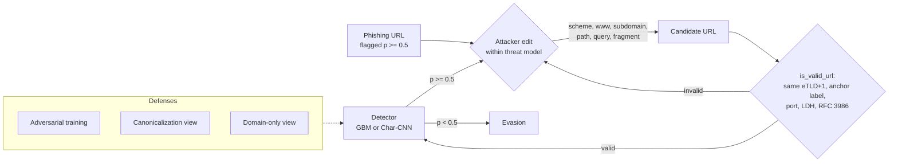

# Cheap Edits, Big Drops: Problem-Space Evasion of URL-Based Phishing Detectors

*mikedsosa. Independent research project, 2026. Code, data pipeline and every
number in this document are at
<https://github.com/mikedsosa/phishing-detector-adversarial-robustness>.
Headline numbers come from the seed-42 runs of `make reproduce` (configs
`full` for PhiUSIIL and `phresh` for PhreshPhish), copied from
[`results/RESULTS.md`](../results/RESULTS.md),
[`results/phreshphish/RESULTS.md`](../results/phreshphish/RESULTS.md) and
their `summary.json` files. Seeds 43 and 44 are summarized in
[`results/SEEDS.md`](../results/SEEDS.md).*

## Abstract

URL-only phishing detectors look near-perfect on public benchmarks. We ask how
much of that accuracy survives an attacker who makes only changes they could
really make to a live phishing URL: switching to HTTPS, adding or removing
`www`, renaming paths, and similar edits, always keeping the registrable
domain fixed. Adversarial URLs pass our syntax and domain-ownership checks,
but we don't check that a rewritten URL still serves the phishing page (for
example, dropping a query string may break a kit's tokens), and the main
threat tier assumes the attacker runs their own server and DNS. We train a scikit-learn gradient-boosted model on 30 lexical
features and a character-level CNN on two CC BY 4.0 datasets. On PhiUSIIL
(235,370 URLs, random split) both reach about 0.998 F1, and a greedy
black-box attack with at most 10 edits evades **61.7%** (GBM) and **63.0%**
(CNN) of the phishing URLs each model detects, usually with one edit. This
traces to an artifact: 99.97% of PhiUSIIL's legitimate URLs are bare
`https://www.<domain>` homepages, and a one-line rule scores 0.9948 F1. On
PhreshPhish (666,313 URLs, time-based split, benign URLs from real browsing)
the format rule fails (0.6072 F1) and clean F1 is a more believable 0.929 /
0.947. But evasion goes *up*: **83.2%** (GBM) and **95.6%** (CNN). Adversarial
training cuts greedy evasion to 34.7% and 17.6%, yet transformations held out
of training still evade 35.2% and 55.1%, and a beam search over 19
transformations evades 70.0% and 97.6%. Models also fail across datasets:
the PhreshPhish-trained GBM flags 99.9% of PhiUSIIL's legitimate URLs, and
PhiUSIIL-trained full-URL models flag 93–100% of PhreshPhish's. Domain-only
models can't be evaded within the threat model (although wrapping the URL in a
link shortener, which is outside our threat model, still evades the
domain-only GBM about 24% of the time) but reach only 0.75–0.85 F1.
An unconstrained feature-space attack (ART HopSkipJump) "succeeds" 99.5–100%
of the time, but at most 6% of its outputs correspond to a realizable URL.
Over three seeds per dataset (42–44), the PhreshPhish baselines' greedy
evasion averages 84.9% (GBM, pooled 95% CI [83.5, 86.2]) and 95.1% (CNN,
[94.2, 95.8]); the adversarially trained models vary more from seed to seed
(CNN held-out evasion 55.1–66.8%), as does the PhiUSIIL baseline CNN (greedy
50.6–63.0%).

## 1. Background and related work

**Adversarial examples and evasion.** Biggio et al. [1] showed that
gradient-based evasion attacks at test time can evade classifiers in
security settings such as PDF-malware detection. Goodfellow et al. [2]
popularized fast gradient attacks and adversarial training for neural
networks, and Madry et al. [3] framed adversarial training as robust
optimization against a defined threat model. For text, HotFlip [4] uses
gradients with respect to one-hot inputs to choose character flips for
character-level classifiers. Our white-box attack adapts that idea to URLs.

**Problem space vs. feature space.** Pierazzi et al. [5] formalized
*problem-space* attacks. These must produce real objects that respect the
domain's constraints (available transformations, preserved semantics,
plausibility), not just feature vectors that cross a decision boundary.
Apruzzese et al. [6] argue that real attackers rarely compute gradients and
instead use cheap, domain-specific tricks. For phishing specifically,
SpacePhish [7] contrasts feature-space and problem-space evasion of ML
phishing-website detectors. Earlier work studied adversarial sampling against
phishing classifiers [8] and adversarial attacks on URL-based phishing
detectors [9]. DeepPhish [25] used an LSTM to generate phishing URLs that
evade an ML detector; it is an author-hosted preprint presented as a
talk, and we found no peer-reviewed version. The closest prior work is Sabir et al. [15], whose URLBUG
attack on 50 URL detectors cut median MCC from 0.92 to 0.02; our results
confirm that cheap problem-space URL edits work, on newer data. Multi-SpacePhish
[16] extends SpacePhish, and Apruzzese & Subrahmanian [17] propose a
phishing-specific defense against gray-box attacks that we do not reimplement.

**Robustness to unseen attacks and evaluation practice.** That adversarial
training against one perturbation type transfers poorly to others is known
(Tramèr & Boneh [18]; Kang et al. [19], whose "unforeseen adversaries" design is
the closest analogue to our held-out edit family). Our contribution there is a
measurement in the URL problem space, not a new concept. We follow the
adaptive-attack guidance of Tramèr et al. [20] and Carlini et al. [21] by
attacking every defended model directly, but with only two adversarial-training
rounds and hand-written edits, so our defended numbers are upper bounds on
robustness. Arp et al. [22] catalogue pitfalls such as data snooping and
spurious correlations, which match the dataset artifacts and the
cross-dataset collapse we report, and TESSERACT [23] argues for
time-aware evaluation, which PhreshPhish's split provides.

**URL-based detection.** Lexical-feature models and character-level CNNs are
standard URL-only baselines. URLNet [10] combines character- and word-level
CNNs over raw URLs, and our CNN is a simpler character-only variant. PhiUSIIL
[11] is a recent large dataset of phishing and legitimate URLs released under
CC BY 4.0. PhreshPhish [14] (also CC BY 4.0) collects phishing pages and benign
pages from real browsing over 2024–2025, removes near-duplicates and
train/test leakage, and ships a time-based split. We use both: PhiUSIIL as the
established benchmark and PhreshPhish as the fairer one.

**Tooling.** We use the Adversarial Robustness Toolbox (ART) [12] to run
HopSkipJump [13], a decision-based attack, as an unconstrained feature-space
baseline.

## 2. Threat model

The full threat model is in [`threat-model.md`](threat-model.md). In short:

* **System:** a URL-only classifier (no page fetch), as in mail or chat link
  scanning, outputting P(phishing). A URL is blocked at P ≥ 0.5.
* **Attacker goal:** evasion. A phishing URL the detector currently flags
  should be scored < 0.5 while still serving the same phishing kit.
* **Knowledge:** black-box with scores (main attack), black-box with random
  choice (weak baseline), and white-box with gradients (CNN only).
* **Capabilities (`owner` tier):** the attacker runs the phishing server and
  DNS, so they may change the scheme, subdomain labels left of the anchor
  label, the path, the query and the fragment. The **registrable domain
  (eTLD+1, including the Public Suffix List's private section), the anchor
  label (the rightmost non-`www` subdomain label) and the port are fixed.**
  Every candidate must be a syntactically valid URL (LDH host labels, ASCII,
  RFC 3986 characters).
* **`append_only` tier:** for compromised or shared hosts, the attacker can only
  append an unused query parameter or a fragment.
* **`heldout` and `extended` tiers:** six further edits within the same
  `owner` capabilities (article-style deep-link paths, file extensions,
  ad-click tracking parameters, trailing-slash toggles, neutral subdomain
  labels, percent-encoding one path letter). Adversarial training never uses
  them. `heldout` allows only these; `extended` allows everything.
* **Budget:** at most 10 perturbations, where one perturbation is one
  transformation or one character flip.
* **Out of scope:** registering new domains, open redirects and link
  shorteners. A shortener wrap is reported separately for context.

## 3. Method

### 3.1 Data

**PhiUSIIL.** PhiUSIIL [11] (UCI dataset 967, CC BY 4.0) is downloaded by
`scripts/download_data.py`, which verifies SHA-256 checksums for the zip and
the CSV. We use only the raw `URL` and `label` columns. Labels are flipped so
that phishing = 1, IDNA labels are converted to A-labels, and duplicates and
conflicting duplicates are dropped. That leaves **235,370 unique URLs (42.7%
phishing)**, split 70/10/20 into train (164,759), validation (23,537) and test
(47,074), stratified, seed 42.

**Dataset structure (all unique URLs):**

| Class | n | https | leading www | non-root path | query | bare `https://www.<domain>` |
|---|---|---|---|---|---|---|
| legitimate | 134,850 | 1.0000 | 0.9997 | 0.0000 | 0.0000 | 0.9997 |
| phishing | 100,520 | 0.4863 | 0.4111 | 0.2714 | 0.0604 | 0.0105 |

Legitimate URLs in PhiUSIIL are homepages collected as `https://www.<domain>`.
A detector can therefore separate the classes largely by URL *format*. We
include a non-learned **format rule** baseline: flag as phishing any URL that
is not of the form `https://www.<domain>`.

**PhreshPhish.** PhreshPhish [14] (Hugging Face `phreshphish/phreshphish`,
revision `eca603e0`, CC BY 4.0, released for anti-phishing research) is a
second, more realistic dataset added in this revision. The full release is
about 37 GB because it includes page HTML; `scripts/download_phreshphish.py`
reads only the URL, label, date and hash columns with HTTP range requests and
verifies a content checksum. No URL is requested. After the same cleaning
there are **666,313 unique URLs (44.8% phishing)**. We keep the published
**time-based split**: training URLs are dated 2024-07-02 to 2025-09-08 and
test URLs 2025-09-08 to 2025-12-16. To keep compute comparable with PhiUSIIL,
models train on a stratified sample of 164,759 training URLs; validation is a
stratified 10% of the training split (49,826), and clean metrics use the full
test split (168,059).

| Class | n | https | leading www | non-root path | query | bare `https://www.<domain>` |
|---|---|---|---|---|---|---|
| legitimate | 367,989 | 0.9784 | 0.5778 | 0.9255 | 0.0002 | 0.0359 |
| phishing | 298,324 | 0.8623 | 0.0710 | 0.4919 | 0.1165 | 0.0246 |

PhreshPhish's legitimate URLs mostly have paths, so the format rule no longer
works. They almost never carry a query string, though. The dataset paper explains
why: query parameters were stripped from benign URLs to remove personal
data [14]. So we add a second non-learned baseline, the **query rule**: flag
any URL with a query string.

### 3.2 Detectors

* **GBM:** scikit-learn `HistGradientBoostingClassifier` (300 iterations,
  63 leaves) on 30 lexical features (lengths, character counts, entropy, IP
  host, suspicious tokens, confusable/punycode flags, and so on) plus a one-hot
  encoding of the 30 most frequent public suffixes.
* **Char-CNN:** PyTorch. Character embedding (dim 32, max length 200),
  parallel 1-D convolutions of width 3, 5 and 7 (128 filters each), masked
  max-pooling and a linear head. 3 epochs, batch 256, Adam at learning rate
  1e-3.

Each detector can read one of three *views* of the URL:
`raw`; `canon` (decode IDNA and map confusables to ASCII, force the scheme to
`http`, strip a leading `www`, trailing `/` and the fragment); and `domain`
(`http://<registrable domain>` only).

### 3.3 Attacks (all problem-space unless noted)

* **Greedy black-box (score-based):** at each step, generate every valid
  neighbor of the current URL under the threat-model transformations, query
  the detector on all of them, and move to the lowest-scoring one. Stop at
  p < 0.5, at the budget, or at a local optimum. Queries are counted.
* **Random black-box:** apply random valid transformations, up to the budget.
* **Greedy, append-only tier:** greedy, restricted to appending a query
  parameter or a fragment.
* **HotFlip white-box (CNN):** first-order estimate of the logit change for
  each allowed character substitution, as in [4]. The top 16 candidates are
  verified exactly and the best is applied. Substitutions are limited to
  alphanumeric characters in non-anchor subdomain labels and the
  path/query/fragment. The attack may first add one attacker-owned subdomain
  label or path segment, which costs one perturbation.
* **Hybrid white-box (CNN):** each step chooses the best of the HotFlip
  candidates and all structural transformations, scored exactly with the
  white-box model.
* **Greedy, held-out transformations:** the greedy attack restricted to the
  `heldout` tier, budget 10. Against adversarially trained models this is an
  adaptive test of whether the defense generalizes beyond the edits it saw.
* **Beam search, extended tier:** beam width 4 over the `extended` tier
  (all 19 transformations), budget 20 edits. It keeps the 4 lowest-scoring
  candidates per URL at each step instead of 1, so it escapes local optima
  that stop the greedy attack. This is our strongest black-box attack and the
  main adaptive attack against the defenses.
* **Link-shortener wrap (out of scope):** replace the URL with a plausible
  shortener URL. One step, reported for context.
* **HopSkipJump (feature space, GBM):** ART's `HopSkipJump` [12, 13] on the
  GBM's feature vectors, seeded with the nearest legitimate training vector.
  200 URLs, 20 iterations. We then check whether each adversarial vector is
  *realizable*: integer and binary features must stay consistent in type, and
  features tied to the registrable domain must not change.

### 3.4 Defenses

1. **Adversarial training (AT):** 2 rounds. In each round we attack 4,000
   randomly chosen training phishing URLs with the greedy attack, add every
   intermediate and final URL from the attack trajectories (labelled
   phishing) to the training set, and retrain from scratch. For the CNN we
   also add hybrid white-box examples for half of the sampled URLs.
   Variants: `gbm_raw_at`, `cnn_raw_at` and `gbm_canon_at`. Round 2 adds
   *mixed* AT (`gbm_raw_mix`, `cnn_raw_mix`), which also adds owner-tier
   beam-search trajectories each round, and score-averaging GBM+CNN
   ensembles (§4.12).
2. **Canonicalization:** train and test on the `canon` view, which removes
   features the attacker controls for free.
3. **Domain-only:** train and test on the registrable domain only. This is
   unaffected by construction by the edits in our threat model, because
   nothing the attacker may change reaches the model. (A link-shortener wrap,
   which is outside the threat model, still evades the domain-only GBM 23.9%
   of the time on PhiUSIIL and 23.5% on PhreshPhish, seed 42.)

### 3.5 Metrics

* **Evasion rate:** among phishing URLs in the attack sample that the model
  flags before the attack (p ≥ 0.5), the fraction whose final adversarial URL
  scores p < 0.5 within the budget.
* **Detection under attack:** the fraction of *all* sampled phishing URLs that
  are still flagged after the attack. This is the fair metric across models
  with different clean recall.
* **Attack sample:** 1,000 phishing URLs drawn at random from the test set
  (seed 42). The same sample is used for every model in a run.
* **Uncertainty:** every evasion rate comes with a 95% Wilson interval over
  the detected URLs. `make reproduce` also re-runs the whole pipeline
  (random split or training sample, model training, adversarial training,
  attack sample) with seeds 43 and 44 on both datasets, and
  `results/SEEDS.md` reports mean and min–max across seeds and a Wilson
  interval on the pooled counts. All six runs (seeds 42–44 on both
  datasets) are in the committed results (§4.6).
* **Cross-dataset:** every model trained on one dataset is also scored on the
  other dataset's test split.

**Compute:** on an 8-core CPU with no GPU, the seed-42 run takes 1,663 s on
PhiUSIIL and 1,725 s on PhreshPhish; seed 43 took 1,793 s on PhreshPhish and
seed 44 1,851 s on PhiUSIIL, so all six runs take about three hours. (The
logged times of the other two seed runs, 8,184 s and 10,434 s, include periods
when the machine was suspended.) Models
train on the full training split (PhreshPhish: a fixed 164,759-URL
subsample, the size of the PhiUSIIL training split). Attacks are subsampled
to 1,000 test phishing URLs and HopSkipJump to 200, and adversarial training
uses 4,000 training phishing URLs per round.

**Reproducibility:** seeds are fixed and PyTorch deterministic mode is on.
Re-running seed 42 on PhiUSIIL after adding the new attacks reproduced every
GBM number exactly, but not the CNN: clean F1 was the same to four decimals,
yet greedy evasion moved from 0.616 to 0.630 and hybrid from 0.686 to 0.710.
We didn't pin down the cause; CNN scores near the 0.5 threshold are evidently
sensitive to small numeric differences between runs. The numbers here are
from the rerun. Seed-to-seed variation (§4.6) is the better guide to how much
any one number can move.

## 4. Results

### 4.1 PhiUSIIL: clean performance (test set, n = 47,074)

| Model | Accuracy | Precision | Recall | F1 | ROC-AUC | FPR |
|---|---|---|---|---|---|---|
| GBM (baseline) | 0.9981 | 0.9995 | 0.9961 | 0.9978 | 0.9984 | 0.0004 |
| Char-CNN (baseline) | 0.9983 | 1.0000 | 0.9959 | 0.9980 | 0.9989 | 0.0000 |
| **Format rule** (not `https://www.<domain>`) | 0.9956 | 0.9998 | 0.9899 | 0.9948 | 0.9949 | 0.0001 |
| GBM + adv. training | 0.9967 | 0.9954 | 0.9969 | 0.9961 | 0.9990 | 0.0034 |
| Char-CNN + adv. training | 0.9972 | 0.9965 | 0.9969 | 0.9967 | 0.9993 | 0.0026 |
| GBM + canonicalization | 0.8882 | 0.9613 | 0.7692 | 0.8546 | 0.9204 | 0.0231 |
| Char-CNN + canonicalization | 0.8984 | 0.9566 | 0.7984 | 0.8704 | 0.9372 | 0.0270 |
| GBM + canon. + adv. training | 0.8885 | 0.9612 | 0.7701 | 0.8551 | 0.9203 | 0.0232 |
| GBM, domain-only | 0.8137 | 0.8895 | 0.6438 | 0.7469 | 0.8679 | 0.0596 |
| Char-CNN, domain-only | 0.8515 | 0.8968 | 0.7372 | 0.8092 | 0.9073 | 0.0633 |
| Query rule (URL has a query string) | 0.5993 | 1.0000 | 0.0617 | 0.1162 | 0.5308 | 0.0000 |

The format rule comes within 0.003 F1 of both learned models. Removing format
cues (canonicalization) costs about 0.13–0.14 F1. That gap is roughly how much
of the "near-perfect" accuracy depends on a dataset artifact rather than on
signals that generalize.

### 4.2 PhiUSIIL: robustness (1,000 phishing test URLs, budget 10)

| Model | Attack | Detected before | Evasion rate [95% Wilson CI] | Detection under attack | Median steps |
|---|---|---|---|---|---|
| GBM (baseline) | Greedy black-box | 995 | **0.617** [0.586, 0.647] | 0.381 | 1 |
| GBM (baseline) | Random | 995 | 0.154 [0.133, 0.178] | 0.842 | 3 |
| GBM (baseline) | Greedy, append-only | 995 | 0.002 [0.001, 0.007] | 0.993 | 1 |
| Char-CNN (baseline) | Greedy black-box | 994 | **0.630** [0.599, 0.659] | 0.368 | 1 |
| Char-CNN (baseline) | Random | 994 | 0.158 [0.137, 0.182] | 0.837 | 3 |
| Char-CNN (baseline) | Greedy, append-only | 994 | 0.000 [0.000, 0.004] | 0.994 | – |
| Char-CNN (baseline) | HotFlip white-box | 994 | 0.026 [0.018, 0.038] | 0.968 | 7 |
| Char-CNN (baseline) | **Hybrid white-box** | 994 | **0.710** [0.681, 0.738] | 0.288 | 2 |
| GBM + adv. training | Greedy black-box | 996 | 0.327 [0.299, 0.357] | 0.670 | 1 |
| Char-CNN + adv. training | Greedy black-box | 997 | 0.289 [0.262, 0.318] | 0.709 | 1 |
| Char-CNN + adv. training | HotFlip white-box | 997 | 0.002 [0.001, 0.007] | 0.995 | 5 |
| Char-CNN + adv. training | Hybrid white-box | 997 | 0.281 [0.254, 0.310] | 0.717 | 1 |
| GBM + canonicalization | Greedy black-box | 781 | 0.165 [0.141, 0.193] | 0.652 | 1 |
| Char-CNN + canonicalization | Greedy black-box | 810 | 0.141 [0.118, 0.166] | 0.696 | 1 |
| GBM + canon. + adv. training | Greedy black-box | 779 | 0.105 [0.086, 0.129] | 0.697 | 1 |
| GBM, domain-only | Greedy black-box | 644 | 0.000 [0.000, 0.006] | 0.644 | – |
| Char-CNN, domain-only | Greedy black-box | 759 | 0.000 [0.000, 0.005] | 0.759 | – |
| GBM, domain-only | Shortener wrap (out of scope) | 644 | 0.239 [0.208, 0.274] | 0.490 | 1 |
| GBM (baseline) | Shortener wrap (out of scope) | 995 | 0.000 [0.000, 0.004] | 0.995 | – |

Seed-42 point estimates with 95% Wilson intervals over the detected URLs.
Evasion rates have different denominators ("Detected before": 644–997), so
compare models on detection under attack, which shares the 1,000-URL
denominator. The full table, covering every model × attack pair, is in
[`results/RESULTS.md`](../results/RESULTS.md).

**Query efficiency (greedy, baseline models):** within 10 queries the attack
already evades 31.7% (GBM) and 34.1% (CNN) of detected phishing URLs. Within
50 queries it evades 60.6% and 62.9%, and it plateaus at 61.7% and 63.0% by
100 queries (`results/evasion_vs_queries.csv`).

**What the attack changes:** across successful greedy attacks on the GBM, the
transformations used were scheme→https (374), path edits (369), subdomain
edits (338) and query/fragment edits (30). For the CNN they were path (391),
scheme (374), subdomain (308) and query/fragment (21). One attack can use
several kinds. The attack mostly makes phishing URLs *look like* the
dataset's legitimate format.

**Transfer:** greedy adversarial URLs crafted against one baseline transfer
almost completely to the other. CNN→GBM evasion is 0.912 (n = 626) and
GBM→CNN is 0.893 (n = 614). They transfer much less to defended models:
0.316–0.503 depending on the target.

**Feature space vs. problem space:** HopSkipJump on the GBM's feature vectors
reaches **100% evasion** (200/200), with a median of 50 features changed and a
median normalized L2 distance of 0.823. But **0%** of its adversarial vectors
are type-consistent, **100%** change features tied to the fixed registrable
domain, and so **0%** are realizable as URLs under the threat model.

### 4.3 PhiUSIIL: held-out edits and beam search

Results from [`results/RESULTS.md`](../results/RESULTS.md), 95% Wilson
intervals in brackets.

| Model | Held-out edits, ≤10 | Beam, extended, ≤20 |
|---|---|---|
| GBM (baseline) | 0.002 [0.001, 0.007] | 0.774 [0.747, 0.799] |
| Char-CNN (baseline) | 0.000 [0.000, 0.004] | 0.844 [0.820, 0.865] |
| GBM + adv. training | 0.000 [0.000, 0.004] | 0.383 [0.353, 0.413] |
| Char-CNN + adv. training | 0.000 [0.000, 0.004] | 0.374 [0.345, 0.405] |
| GBM + canonicalization | 0.013 [0.007, 0.023] | 0.182 [0.156, 0.210] |
| Char-CNN + canonicalization | 0.000 [0.000, 0.005] | 0.147 [0.124, 0.173] |
| GBM + canon. + adv. training | 0.003 [0.001, 0.009] | 0.109 [0.089, 0.133] |

The held-out edits do almost nothing on PhiUSIIL. That fits the shortcut:
they add paths, file extensions, parameters and subdomains, which all move a
URL *away* from the bare-homepage look that PhiUSIIL's models treat as
legitimate. The beam search over all 19 transformations is stronger than
greedy on every model. On the adversarially trained models it reaches 0.383
(GBM) and 0.374 (CNN), against 0.327 and 0.289 for greedy.

### 4.4 PhreshPhish (time split; 1,000 phishing test URLs)

All numbers in this subsection are from
[`results/phreshphish/RESULTS.md`](../results/phreshphish/RESULTS.md)
(config `phresh`, seed 42). Brackets are 95% Wilson intervals.

**Clean performance (test n = 168,059).** The learned models are clearly
less accurate than on PhiUSIIL, and the PhiUSIIL format rule no longer works
(F1 0.6072). The query rule has precision 0.9972 but recall 0.2396 (F1
0.3863). So the shortcut still exists, but it covers about a quarter of the
phishing URLs rather than nearly all of them.

| Model | Precision | Recall | F1 | ROC-AUC | FPR |
|---|---|---|---|---|---|
| GBM (baseline) | 0.9611 | 0.8987 | 0.9289 | 0.9811 | 0.0306 |
| Char-CNN (baseline) | 0.9723 | 0.9221 | 0.9465 | 0.9888 | 0.0221 |
| GBM + adv. training | 0.9520 | 0.9135 | 0.9323 | 0.9814 | 0.0388 |
| Char-CNN + adv. training | 0.9437 | 0.9562 | 0.9499 | 0.9904 | 0.0480 |
| GBM + canonicalization | 0.9473 | 0.8559 | 0.8993 | 0.9715 | 0.0400 |
| Char-CNN + canonicalization | 0.9657 | 0.8871 | 0.9248 | 0.9849 | 0.0265 |
| GBM + canon. + adv. training | 0.9387 | 0.8688 | 0.9024 | 0.9701 | 0.0478 |
| GBM, domain-only | 0.8933 | 0.7526 | 0.8170 | 0.9144 | 0.0757 |
| Char-CNN, domain-only | 0.9551 | 0.7587 | 0.8456 | 0.9478 | 0.0300 |
| Format rule | 0.4504 | 0.9316 | 0.6072 | 0.4875 | 0.9566 |
| Query rule | 0.9972 | 0.2396 | 0.3863 | 0.6195 | 0.0006 |

Adversarial training slightly *raises* clean F1 here, but it also raises FPR
(GBM 3.06% → 3.88%, CNN 2.21% → 4.80%, seed 42). The GBM's rise repeats on
seeds 43 and 44 (2.99% → 3.84%, 3.12% → 3.88%); the CNN's does not (2.38% →
2.35%, 3.13% → 2.35%), so the CNN's FPR cost is seed-dependent.

**Robustness.**

| Model | Detected before | Greedy (owner) | Held-out edits | Beam, extended | Append-only |
|---|---|---|---|---|---|
| GBM (baseline) | 910 | **0.832** [0.806, 0.855] | 0.482 [0.450, 0.515] | 0.959 [0.944, 0.970] | 0.007 [0.003, 0.014] |
| Char-CNN (baseline) | 931 | **0.956** [0.941, 0.967] | 0.755 [0.726, 0.782] | 1.000 [0.996, 1.000] | 0.000 [0.000, 0.004] |
| GBM + adv. training | 922 | 0.347 [0.317, 0.378] | 0.352 [0.322, 0.384] | 0.700 [0.669, 0.728] | 0.007 [0.003, 0.014] |
| Char-CNN + adv. training | 962 | 0.176 [0.153, 0.201] | 0.551 [0.519, 0.582] | 0.976 [0.964, 0.984] | 0.000 [0.000, 0.004] |
| GBM + canonicalization | 860 | 0.569 [0.535, 0.601] | 0.417 [0.385, 0.451] | 0.773 [0.744, 0.800] | 0.000 [0.000, 0.004] |
| Char-CNN + canonicalization | 889 | 0.918 [0.898, 0.934] | 0.724 [0.694, 0.753] | 1.000 [0.996, 1.000] | 0.000 [0.000, 0.004] |
| GBM + canon. + adv. training | 865 | 0.216 [0.190, 0.245] | 0.379 [0.347, 0.412] | 0.645 [0.613, 0.676] | 0.000 [0.000, 0.004] |
| GBM, domain-only | 745 | 0.000 [0.000, 0.005] | – | – | 0.000 [0.000, 0.005] |
| Char-CNN, domain-only | 764 | 0.000 [0.000, 0.005] | – | – | 0.000 [0.000, 0.005] |

Evasion denominators are each model's detected URLs ("Detected before",
745–962), so they differ across models: the adversarially trained CNN's
0.176 is out of 962 flagged URLs, the baseline GBM's 0.832 out of 910.
Detection under attack (§4.7) uses the same 1,000 URLs for every model.

On the baseline CNN, HotFlip alone evades 0.565 [0.533, 0.596] and the
hybrid white-box attack 0.977 [0.966, 0.985]. After adversarial training they
fall to 0.415 and 0.407. Median greedy steps on successful attacks are 2 for
both baselines. The out-of-scope shortener wrap evades 0.235 of the GBM
domain-only model's detections.

Four things stand out.

* **More realistic benign data made evasion easier.** Benign PhreshPhish URLs
  are mostly deep links (92.5% have a non-root path), so the models can't
  lean on "homepage = legitimate". They lean on path and subdomain content
  instead, and those are exactly what the attacker controls. Successful
  greedy attacks mostly used path edits (GBM 1,264, CNN 1,460), then
  subdomain edits (456, 478), query/fragment edits (238, 178) and
  scheme→https (88, 128). On PhiUSIIL, scheme changes dominated.
* **Adversarial training generalizes poorly.** For the GBM, held-out evasion
  after training (0.352) is about the same as greedy evasion (0.347). For the
  CNN, held-out evasion (0.551) is three times greedy evasion (0.176). Beam
  search over all 19 transformations with budget 20 still gets 0.700 (GBM)
  and 0.976 (CNN). The CNN's adversarial-training gain is almost entirely
  specific to the transformations it was trained on.
* **Canonicalization helps the GBM more than the CNN.** It lowers GBM greedy
  evasion from 0.832 to 0.569, but CNN evasion only from 0.956 to 0.918.
* **Domain-only models are still unevadable within the threat model**, at
  clean F1 0.82–0.85.

**Transfer.** Greedy adversarial URLs transfer much less between the two
baselines than on PhiUSIIL: GBM→CNN 0.577 (n = 757) and CNN→GBM 0.421
(n = 890). Transfer to the adversarially trained CNN is 0.091–0.094.

**Feature space vs. problem space.** HopSkipJump on the GBM (200 URLs, one
aborted at the call cap) reaches 0.995 evasion with a median of 51 features
changed. Only 6.0% of the successful vectors are type-consistent, 94.0%
touch features tied to the fixed registrable domain, and 6.0% are
realizable under the threat model.

### 4.5 Cross-dataset transfer

Models trained on PhreshPhish and scored on the PhiUSIIL test split
([`results/phreshphish/cross_dataset.csv`](../results/phreshphish/cross_dataset.csv)):

| Model | Precision | Recall | F1 | FPR |
|---|---|---|---|---|
| GBM (baseline) | 0.4111 | 0.9354 | 0.5712 | 0.9987 |
| Char-CNN (baseline) | 0.6501 | 0.9263 | 0.7640 | 0.3717 |
| GBM + adv. training | 0.4135 | 0.9435 | 0.5750 | 0.9974 |
| Char-CNN + adv. training | 0.4560 | 0.9576 | 0.6178 | 0.8515 |
| GBM + canonicalization | 0.6964 | 0.7566 | 0.7253 | 0.2459 |
| Char-CNN + canonicalization | 0.7326 | 0.7404 | 0.7365 | 0.2014 |
| GBM, domain-only | 0.7797 | 0.6056 | 0.6817 | 0.1275 |
| Char-CNN, domain-only | 0.8540 | 0.6151 | 0.7151 | 0.0784 |

The PhreshPhish GBM flags 99.87% of PhiUSIIL's legitimate URLs. Those are
bare homepages, which are rare among PhreshPhish benign URLs (3.6%). The
models trained on each benchmark learned its formatting habits, in opposite
directions. Canonicalized and domain-only models transfer better because
they see less of the format.

The other direction is starker
([`results/cross_dataset.csv`](../results/cross_dataset.csv)). Every
PhiUSIIL-trained model that sees the full URL flags 92.6–100% of
PhreshPhish's legitimate URLs (FPR 0.9263–1.0000), with F1 0.5995–0.6175,
the same as the format rule (0.6072). The domain-only models are the only
ones that carry over: F1 0.7651 (GBM) and 0.8350 (CNN), FPR 0.0952 and
0.0827. The PhiUSIIL models have, in effect, learned the format rule.

### 4.6 Variation across seeds

[`results/SEEDS.md`](../results/SEEDS.md) has every model and attack. The
committed results include **seeds 42, 43 and 44 on both datasets** (six
runs). Each cell below is the mean over the three seeds, the 95% Wilson
interval on the evasions pooled over the seeds (sampling error only), and the
per-seed min–max. Clean F1 is listed per seed without an interval.
Pooled denominators (flagged URLs over three seeds) are 2,729–2,834 per model
on PhreshPhish and 2,989–2,993 on PhiUSIIL.

PhreshPhish, seeds 42–44:

| Model | Greedy | Held-out edits | Beam, extended | Clean F1 (per seed) |
|---|---|---|---|---|
| GBM (baseline) | 0.849 [0.835, 0.862], 0.832–0.861 | 0.493 [0.474, 0.512], 0.482–0.498 | 0.961 [0.953, 0.967], 0.954–0.969 | 0.9289 / 0.9312 / 0.9314 |
| Char-CNN (baseline) | 0.951 [0.942, 0.958], 0.942–0.956 | 0.732 [0.715, 0.748], 0.693–0.755 | 1.000 [0.998, 1.000], 0.999–1.000 | 0.9465 / 0.9512 / 0.9515 |
| GBM + adv. training | 0.367 [0.350, 0.386], 0.347–0.400 | 0.395 [0.377, 0.414], 0.352–0.418 | 0.725 [0.708, 0.741], 0.700–0.750 | 0.9323 / 0.9317 / 0.9320 |
| Char-CNN + adv. training | 0.229 [0.214, 0.244], 0.176–0.269 | 0.621 [0.603, 0.638], 0.551–0.668 | 0.987 [0.982, 0.991], 0.976–0.994 | 0.9499 / 0.9550 / 0.9492 |

PhiUSIIL, seeds 42–44 (held-out edits evade at most 0.002 for these four
models, so that column is omitted):

| Model | Greedy | Beam, extended | Hybrid white-box | Clean F1 (per seed) |
|---|---|---|---|---|
| GBM (baseline) | 0.635 [0.618, 0.652], 0.617–0.645 | 0.798 [0.783, 0.812], 0.774–0.812 | – | 0.9978 / 0.9977 / 0.9980 |
| Char-CNN (baseline) | 0.579 [0.561, 0.596], 0.506–0.630 | 0.827 [0.813, 0.840], 0.797–0.844 | 0.624 [0.607, 0.641], 0.527–0.710 | 0.9980 / 0.9980 / 0.9981 |
| GBM + adv. training | 0.343 [0.326, 0.360], 0.327–0.358 | 0.412 [0.394, 0.430], 0.383–0.432 | – | 0.9961 / 0.9960 / 0.9957 |
| Char-CNN + adv. training | 0.298 [0.282, 0.315], 0.289–0.309 | 0.412 [0.394, 0.430], 0.374–0.443 | 0.298 [0.282, 0.314], 0.281–0.317 | 0.9967 / 0.9971 / 0.9961 |

On PhreshPhish the baselines are fairly stable: their per-seed rates span at
most 2.9 points under the greedy and beam attacks and 6.2 points under
held-out edits (CNN). The adversarially trained models move more (CNN greedy
0.176–0.269, held-out 0.551–0.668), which fits the picture that their
robustness is narrow and depends on what the training-time attack happened to
find. On PhiUSIIL the baseline CNN is the least stable cell: greedy evasion
0.506–0.630 and hybrid 0.527–0.710 with clean F1 identical to three decimals,
the same sensitivity near the threshold noted in §3.5. Every conclusion in §4.2–4.4
holds for all three seeds on both datasets. Across seeds the append-only tier
reaches at most 0.012 (PhreshPhish GBM + adv. training, seed 43).

### 4.7 Defense tradeoffs

Clean F1, greedy evasion and detection under greedy attack, as GBM / CNN
(seed 42 point estimates; the 95% Wilson intervals for each evasion rate are
in §4.2 and §4.4 and the three-seed ranges in §4.6). Evasion is over each
model's own detected URLs, so its denominator varies by model; detection
under attack is over the same 1,000 sampled URLs and is the like-for-like
column:

| Defense | PhiUSIIL F1 | PhiUSIIL evasion | PhiUSIIL detection | PhreshPhish F1 | PhreshPhish evasion | PhreshPhish detection |
|---|---|---|---|---|---|---|
| None | 0.9978 / 0.9980 | 0.617 / 0.630 | 0.381 / 0.368 | 0.9289 / 0.9465 | 0.832 / 0.956 | 0.153 / 0.041 |
| Adversarial training | 0.9961 / 0.9967 | 0.327 / 0.289 | 0.670 / 0.709 | 0.9323 / 0.9499 | 0.347 / 0.176 | 0.602 / 0.793 |
| Canonicalization | 0.8546 / 0.8704 | 0.165 / 0.141 | 0.652 / 0.696 | 0.8993 / 0.9248 | 0.569 / 0.918 | 0.371 / 0.073 |
| Canon. + adv. training (GBM) | 0.8551 / – | 0.105 / – | 0.697 / – | 0.9024 / – | 0.216 / – | 0.678 / – |
| Domain-only | 0.7469 / 0.8092 | 0.000 / 0.000 | 0.644 / 0.759 | 0.8170 / 0.8456 | 0.000 / 0.000 | 0.745 / 0.764 |

* **Adversarial training** is cheap in clean F1 on both datasets, but it
  raises FPR (PhiUSIIL: 0.0004 → 0.0034 GBM, 0 → 0.0026 CNN; PhreshPhish:
  0.0306 → 0.0388 GBM, 0.0221 → 0.0480 CNN). On seeds 43 and 44 the
  PhreshPhish CNN's FPR did not rise (0.0238 → 0.0235, 0.0313 → 0.0235),
  while the GBM's did on every seed. It roughly halves greedy
  evasion on PhiUSIIL and cuts it by more on PhreshPhish. Against the
  stronger beam search it holds up on PhiUSIIL (0.383 / 0.374) but not on
  PhreshPhish (0.700 / 0.976), where held-out edits also get through
  (0.352 / 0.551).
* **Canonicalization** costs 0.13–0.14 F1 on PhiUSIIL but only 0.02–0.03 on
  PhreshPhish, because PhreshPhish's legitimate URLs don't share one format.
  On PhreshPhish it helps the GBM (0.832 → 0.569) far more than the CNN
  (0.956 → 0.918).
* **Domain-only** is unevadable *within* our threat model by construction
  (a link-shortener wrap, outside the threat model, still evades the
  domain-only GBM about 24% of the time).
  On PhreshPhish its detection under greedy attack (0.745 / 0.764) is close
  to the best model's (adversarially trained CNN, 0.793), and unlike that
  model it doesn't fall under beam search (CNN + adv. training: 0.023). Its clean recall (0.64–0.76) and FPR (3–8%)
  make it a weak detector alone, and an out-of-scope link shortener evades
  about a quarter of the GBM domain model's detections in one step (0.239
  PhiUSIIL, 0.235 PhreshPhish).

### 4.8 Drift over time (PhreshPhish)

PhreshPhish's split is chronological (training URLs 2024-07-02 to
2025-09-08, test URLs 2025-09-08 to 2025-12-16), so the test set already
measures temporal drift. Breaking it down by month with the seed-42 models
([`results/drift/DRIFT.md`](../results/drift/DRIFT.md); 95% Wilson
intervals):

| Model | Validation (training period) | Sep 2025 | Oct 2025 | Nov 2025 | Dec 2025 FPR (benign only, n = 1,017) |
|---|---|---|---|---|---|
| GBM (baseline) | recall 95.9% [95.6, 96.1], FPR 2.7% | recall 58.7% [57.2, 60.1], FPR 2.8% | 91.4%, 3.1% | 92.5%, 3.1% | 8.4% [6.8, 10.2] |
| Char-CNN (baseline) | 95.7% [95.4, 96.0], 1.9% | 85.0% [83.9, 86.1], 2.0% | 92.4%, 2.2% | 93.2%, 2.3% | 8.8% [7.3, 10.8] |
| GBM + adv. training | 96.2%, 3.5% | 60.3%, 3.6% | 93.2%, 3.9% | 93.0%, 3.9% | 8.2% [6.6, 10.0] |
| Char-CNN + adv. training | 97.5%, 4.2% | 89.2%, 4.5% | 95.9%, 4.7% | 96.3%, 5.1% | 15.6% [13.5, 18.0] |

The September dip comes from only 4,279 phishing URLs, so it may reflect a
few campaigns rather than a gradual trend; the December FPR rise uses only
1,017 benign URLs. Both are drift the random validation split would not show.

### 4.9 Query budgets and label-only access

All attacks above see the model's score and get unlimited queries. Two
cheaper attackers, on PhreshPhish, seeds 42–44
([`results/SEEDS.md`](../results/SEEDS.md), `evasion_vs_queries.csv`):

* **Query budget.** Successful greedy attacks need a median of 1 (PhiUSIIL)
  or 2 (PhreshPhish) edits, so the score-query assumption costs the attacker
  little. The greedy attack evades 17.0% (GBM) and 18.1% (CNN) of
  flagged URLs within 10 score queries and 81.7% (per-seed 79.2–83.5%) and
  90.8% (86.7–93.1%) within 50.
* **Label-only.** Applying random valid edits and checking only the verdict
  evades 27.0% [25.4, 28.7] (GBM), 25.9% [24.3, 27.6] (CNN), 11.8%
  [10.6, 13.0] (GBM + adv. training) and 7.9% [6.9, 8.9] (CNN + adv.
  training) within 10 edits. This is a weak decision-based attack; a
  stronger one would do better.

### 4.10 Domain leakage in PhiUSIIL's random split

With the random split, 38.6% of phishing test URLs (mean of seeds 42–44;
38.5–38.7% per seed) share a registrable domain with a phishing training URL, against about
2.3% (2.3–2.4%) of legitimate test URLs
([`results/domain_leakage.csv`](../results/domain_leakage.csv)). (PhreshPhish's time split has some overlap too:
17.4% of phishing and 58.1% of benign test URLs, seed 42; for benign URLs
this is expected, since popular sites recur.) We added a domain-grouped
70/10/20 split (`--config full-grouped`, scikit-learn `GroupShuffleSplit` on
the registrable domain; zero overlap). For the GBM, seeds 42–44
([`results/phiusiil-grouped-gbm-preview/SUMMARY.md`](../results/phiusiil-grouped-gbm-preview/SUMMARY.md)):

| | Random split | Domain-grouped split |
|---|---|---|
| GBM clean F1 (FPR) | 0.9978 (0.0004) | 0.9977 (0.0005) |
| GBM greedy | 0.635 [0.618, 0.652] | 0.617 [0.600, 0.635] |
| GBM beam | 0.798 [0.783, 0.812] | 0.828 [0.814, 0.841] |
| GBM + adv. training, greedy | 0.343 [0.326, 0.360] | 0.348 [0.331, 0.366] |
| GBM + adv. training, beam | 0.412 [0.394, 0.430] | 0.414 [0.397, 0.432] |

Cells are the mean over seeds with pooled 95% Wilson intervals; clean F1 and
FPR are means without intervals. Denominators are 2,989–2,992 flagged URLs
pooled over seeds in every cell.

The leak barely moves the GBM's numbers; beam evasion is 3 points higher on
the grouped split. The format shortcut (§4.1) dominates. The char-CNN, same
cell format ([`results/SEEDS.md`](../results/SEEDS.md)):

| | Random split | Domain-grouped split |
|---|---|---|
| CNN clean F1 | 0.9980 | 0.9978 |
| CNN greedy | 0.579 [0.561, 0.596] | 0.545 [0.527, 0.563] |
| CNN beam | 0.827 [0.813, 0.840] | 0.821 [0.806, 0.834] |
| CNN + adv. training, greedy | 0.298 [0.282, 0.315] | 0.324 [0.308, 0.341] |
| CNN + adv. training, beam | 0.412 [0.394, 0.430] | 0.469 [0.451, 0.487] |

The baseline CNN is no easier to evade on the grouped split. The
adversarially trained CNN is somewhat easier to evade there under beam
search (0.469 vs. 0.412, non-overlapping intervals), so the random split
slightly flattered that defense.

### 4.11 Low base rates and low-FPR thresholds (PhreshPhish, seed 42)

Reweighting phishing test URLs to 1% of traffic, precision at 90% recall is
22.5% (GBM), 40.0% (CNN), 24.3% (GBM + adv. training) and 52.1% (CNN + adv.
training); at 0.05% it is 1.4–5.1%. With thresholds chosen on validation data
for at most 0.1% FPR (test FPR 0.12–0.15%, recall 70.3–75.5%), greedy evasion
rises to 99.2% (GBM), 98.4% (CNN), 73.8% (GBM + adv. training) and 38.5% (CNN
+ adv. training), from 83.2%, 95.6%, 34.7% and 17.6% at t = 0.5
([`results/operating/phreshphish/OPERATING.md`](../results/operating/phreshphish/OPERATING.md)).
Stricter thresholds trade recall for false positives but make evasion easier.

On PhiUSIIL's domain-grouped split (seed 42,
[`results/operating/phiusiil-grouped/OPERATING.md`](../results/operating/phiusiil-grouped/OPERATING.md))
the base-rate problem largely disappears: precision at 90% recall is 100.0%
for all four models down to a 0.05% base rate (AP 0.995–0.997). This is the
format shortcut again, not robustness. The default threshold already gives
test FPRs of 0.00–0.34%, so the thresholds chosen for 1% and 0.1% validation
FPR are mostly below 0.5 and evasion does not rise (e.g. `cnn_raw` greedy
0.644 [0.614, 0.673] at t = 0.5, 0.413 [0.382, 0.444] at the 1% target and
0.497 [0.466, 0.528] at 0.1%).

### 4.12 Mixed adversarial training and ensembles (seeds 42–44)

Two more defenses: *mixed* AT (`*_raw_mix`), which adds owner-tier
beam-search trajectories to each AT round, and score-averaging GBM+CNN
ensembles of the baseline, AT and mixed-AT pairs. All models are retrained
from scratch for this experiment (`python -m phishadv.defenses`), so baseline
numbers differ slightly from §4.2–4.4. We report the share of the 1,000
sampled phishing URLs per seed still caught after the attack (pooled over
seeds, 95% Wilson intervals) and compare defenses with exact McNemar tests on
the same URLs ([`results/defenses/DEFENSES.md`](../results/defenses/DEFENSES.md)).
PhreshPhish:

| Model | Clean FPR | Greedy | Held-out | Beam |
|---|---|---|---|---|
| `gbm_raw` | 0.031 | 0.137 [0.125, 0.150] | 0.461 [0.444, 0.479] | 0.036 [0.030, 0.043] |
| `gbm_raw_at` | 0.039 | 0.582 [0.564, 0.600] | 0.556 [0.538, 0.574] | 0.253 [0.238, 0.269] |
| `gbm_raw_mix` | 0.045 | 0.655 [0.637, 0.671] | 0.587 [0.569, 0.604] | 0.259 [0.244, 0.275] |
| `cnn_raw` | 0.027 | 0.039 [0.033, 0.047] | 0.252 [0.236, 0.268] | 0.000 [0.000, 0.001] |
| `cnn_raw_at` | 0.038 | 0.771 [0.756, 0.786] | 0.366 [0.349, 0.383] | 0.011 [0.008, 0.015] |
| `cnn_raw_mix` | 0.035 | 0.768 [0.753, 0.783] | 0.298 [0.282, 0.315] | 0.006 [0.004, 0.009] |
| ensemble | 0.021 | 0.049 [0.042, 0.058] | 0.354 [0.337, 0.372] | 0.003 [0.002, 0.006] |
| ensemble, AT | 0.029 | 0.741 [0.725, 0.756] | 0.537 [0.519, 0.555] | 0.186 [0.172, 0.200] |
| ensemble, mixed AT | 0.029 | 0.767 [0.751, 0.781] | 0.525 [0.507, 0.542] | 0.152 [0.140, 0.165] |

* Mixed AT improves the GBM against greedy (0.655 vs. 0.582, p = 1.5e-33)
  and held-out edits (0.587 vs. 0.556, p = 6.6e-11) but not against beam
  search (0.259 vs. 0.253, p = 0.27), at a higher clean FPR (0.045 vs. 0.039).
* For the CNN, mixed AT leaves greedy unchanged (p = 0.64) and is worse on
  held-out edits (0.298 vs. 0.366, p = 1.7e-25) and beam (0.006 vs. 0.011,
  p = 0.00027).
* The AT ensemble is below the AT GBM under beam search (0.186 vs. 0.253,
  p = 1e-36) and held-out edits (0.537 vs. 0.556, p = 0.0021), with a lower
  clean FPR (0.029 vs. 0.039).
* On PhiUSIIL (domain-grouped), held-out edit evasion is 0.0% for every model; mixed AT gives
  small significant gains under beam search (GBM 0.607 vs. 0.584, CNN 0.578
  vs. 0.529, ensemble 0.617 vs. 0.560; all p < 1e-8) at clean FPRs of
  0.002–0.007.

No defense we tried survives the beam search on PhreshPhish: the best still
lets roughly three in four flagged URLs through.

## 5. Limitations and honest negatives

* **Both benchmarks have collection artifacts.** Legitimate URLs in PhiUSIIL
  are almost all bare `https://www.<domain>` homepages, so "switch to HTTPS
  and add `www`" is a strong evasion there. PhreshPhish fixes that, but its
  benign URLs had their query strings removed for privacy [14], so "has a
  query string" is a near-certain phishing signal (query rule precision
  0.9972). Our numbers measure robustness *of detectors trained on these
  benchmarks*, not of production systems.
* **Fairer data did not mean more robust models.** We expected evasion to
  fall on PhreshPhish. It rose (greedy 0.832 / 0.956 vs. 0.617 / 0.630). We
  report this as measured. One likely reason is that real benign URLs carry
  deep paths, so path content becomes a strong feature, and path content is
  free for the attacker to change.
* **The `owner` tier is an upper bound and `append_only` is a lower bound.**
  We can't tell which phishing URLs are on attacker-owned infrastructure and
  which are on compromised sites. Under the append-only tier, evasion is at
  most 0.012 for every model, dataset and seed. The large numbers depend on
  the attacker controlling the server and DNS.
* **Adversarial training was tested against new edits, and mostly failed
  that test.** It uses only the owner-tier transformations. Against the six
  held-out transformations and the 19-transformation beam search, its gains
  shrink or vanish, especially for the CNN (§4.4). We did not try stronger
  adversarial-training schemes (for example, training against the beam
  attack or randomly sampled transformation sets).
* **The beam attack is stronger, not strongest.** Width 4 and budget 20 is a
  modest search. Higher budgets would only raise evasion, so the beam
  numbers are lower bounds for that threat tier.
* **URL only.** Detectors never see page content, hosting, certificates or
  reputation, which real filters use. A URL-only layer that is easy to evade
  can still be useful inside a larger system.
* **Limited seeds.** The committed results cover three seeds (42–44) on each
  dataset (§4.6). That shows run-to-run variation, which is large for some
  cells (PhiUSIIL baseline CNN greedy 0.506–0.630), but three seeds are not a
  variance study. Per-run sampling
  error on 1,000 attacked URLs is shown as Wilson intervals.
* **Attacks are subsampled** (1,000 URLs; HopSkipJump 200 URLs) and
  PhreshPhish training uses a fixed 164,759-URL subsample, to keep compute
  modest.
* **Hand-written transformations only.** An attacker could also ask a
  language model to rewrite paths and subdomains so they read naturally. We
  did not test that, because doing it well needs a paid API or a large local
  model. It is the most obvious next step.
* **Validity isn't liveness.** We check syntax and ownership constraints, not
  whether each rewritten URL would still serve the kit.
* **Two baselines only.** We test a lexical GBM and a character CNN. There is
  no URLNet [10] or transformer model, no deployed commercial detector, and
  no reimplementation of the gray-box defense of Apruzzese & Subrahmanian
  [17]. We also built no attack aimed specifically at canonicalization and
  tried no LLM-written URL rewrites.
* **One source per dataset, and the domain definition matters.** Each
  benchmark comes from a single collection pipeline. Many of PhreshPhish's
  most common phishing domains are hosting platforms, and whether a tenant
  subdomain counts as its own registrable domain depends on the Public
  Suffix List's private section, which sets what the `owner` tier lets the
  attacker change.
* **Paired tests only for the round-2 defenses.** §4.12 compares defenses
  with exact McNemar tests on the same attacked URLs. The other tables'
  Wilson intervals are per model and per attack, not paired comparisons.
  Where two intervals overlap there (for example, GBM greedy evasion on
  PhiUSIIL's random vs. domain-grouped split, 0.635 [0.618, 0.652] vs. 0.617
  [0.600, 0.635], which are different URL samples and cannot be paired),
  read the difference as unresolved.

## 6. Ethics

All data is public and CC BY 4.0. PhreshPhish's authors ask that it be used
only for anti-phishing research, which this is. The attacks only rewrite URL strings offline.
We never resolve, visit or deploy any URL, and we never touch any production
detector. The transformations are well known to phishers already, since this
is the simple, gradient-free behaviour described in [6]. The contribution is
a measurement and a set of defenses for defenders. Example URLs in the
results are defanged (`hxxp`, `[.]`). Per-URL adversarial outputs are
git-ignored and not published, though the bundled CI samples do contain real
phishing URLs from the datasets. Don't visit them. The demo CLI takes one URL
at a time, prints only defanged URLs, and has no batch mode. It is not
deployed anywhere.

## References

1. B. Biggio, I. Corona, D. Maiorca, B. Nelson, N. Šrndić, P. Laskov,
   G. Giacinto, F. Roli. "Evasion Attacks against Machine Learning at Test
   Time." ECML PKDD 2013, LNCS 8190, pp. 387–402.
   doi:10.1007/978-3-642-40994-3_25. arXiv:1708.06131.
2. I. J. Goodfellow, J. Shlens, C. Szegedy. "Explaining and Harnessing
   Adversarial Examples." ICLR 2015. arXiv:1412.6572.
3. A. Madry, A. Makelov, L. Schmidt, D. Tsipras, A. Vladu. "Towards Deep
   Learning Models Resistant to Adversarial Attacks." ICLR 2018.
   arXiv:1706.06083.
4. J. Ebrahimi, A. Rao, D. Lowd, D. Dou. "HotFlip: White-Box Adversarial
   Examples for Text Classification." ACL 2018 (short papers), pp. 31–36.
   doi:10.18653/v1/P18-2006.
5. F. Pierazzi, F. Pendlebury, J. Cortellazzi, L. Cavallaro. "Intriguing
   Properties of Adversarial ML Attacks in the Problem Space." IEEE S&P 2020.
   doi:10.1109/SP40000.2020.00073. arXiv:1911.02142.
6. G. Apruzzese, H. S. Anderson, S. Dambra, D. Freeman, F. Pierazzi,
   K. Roundy. "'Real Attackers Don't Compute Gradients': Bridging the Gap
   Between Adversarial ML Research and Practice." IEEE SaTML 2023.
   doi:10.1109/SaTML54575.2023.00031. arXiv:2212.14315.
7. G. Apruzzese, M. Conti, Y. Yuan. "SpacePhish: The Evasion-space of
   Adversarial Attacks against Phishing Website Detectors using Machine
   Learning." ACSAC 2022, pp. 171–185. doi:10.1145/3564625.3567980.
8. H. Shirazi, B. Bezawada, I. Ray, C. Anderson. "Adversarial Sampling
   Attacks Against Phishing Detection." DBSec 2019, LNCS 11559, pp. 83–101.
   doi:10.1007/978-3-030-22479-0_5.
9. A. AlEroud, G. Karabatis. "Bypassing Detection of URL-based Phishing
   Attacks Using Generative Adversarial Deep Neural Networks." IWSPA 2020
   (ACM CODASPY workshop), pp. 53–60. doi:10.1145/3375708.3380315.
10. H. Le, Q. Pham, D. Sahoo, S. C. H. Hoi. "URLNet: Learning a URL
    Representation with Deep Learning for Malicious URL Detection." 2018.
    arXiv:1802.03162.
11. A. Prasad, S. Chandra. "PhiUSIIL: A diverse security profile empowered
    phishing URL detection framework based on similarity index and
    incremental learning." Computers & Security 136 (2024) 103545.
    doi:10.1016/j.cose.2023.103545.
12. M.-I. Nicolae et al. "Adversarial Robustness Toolbox v1.0.0." 2018.
    arXiv:1807.01069.
13. J. Chen, M. I. Jordan, M. J. Wainwright. "HopSkipJumpAttack: A
    Query-Efficient Decision-Based Attack." IEEE S&P 2020. arXiv:1904.02144.
14. T. Dalton, H. Gowda, G. Rao, S. Pargi, A. H. Khodabakhshi, J. Rombs,
    S. Jou, M. Marwah. "PhreshPhish: A Real-World, High-Quality, Large-Scale
    Phishing Website Dataset and Benchmark." 2025. arXiv:2507.10854.
15. H. Sabir, R. Gaire, A. Abuadbba. "Reliability and Robustness analysis of
    Machine Learning based Phishing URL Detectors." IEEE TDSC, 2022.
    doi:10.1109/TDSC.2022.3218043. arXiv:2005.08454.
16. Y. Yuan, G. Apruzzese, M. Conti. "Multi-SpacePhish: Extending the
    Evasion-space of Adversarial Attacks against Phishing Website Detectors
    using Machine Learning." ACM DTRAP 5(2), Art. 16, 2024. doi:10.1145/3638253.
17. G. Apruzzese, V. S. Subrahmanian. "Mitigating Adversarial Gray-Box Attacks
    Against Phishing Detectors." IEEE TDSC 20(5), 2023.
    doi:10.1109/TDSC.2022.3210029.
18. F. Tramèr, D. Boneh. "Adversarial Training and Robustness for Multiple
    Perturbations." NeurIPS 2019. arXiv:1904.13000.
19. D. Kang, Y. Sun, D. Hendrycks, T. Brown, J. Steinhardt. "Testing Robustness
    Against Unforeseen Adversaries." arXiv:1908.08016.
20. F. Tramèr, N. Carlini, W. Brendel, A. Madry. "On Adaptive Attacks to
    Adversarial Example Defenses." NeurIPS 2020. arXiv:2002.08347.
21. N. Carlini et al. "On Evaluating Adversarial Robustness." 2019.
    arXiv:1902.06705.
22. D. Arp et al. "Dos and Don'ts of Machine Learning in Computer Security."
    USENIX Security 2022. arXiv:2010.09470.
23. F. Pendlebury, F. Pierazzi, R. Jordaney, J. Kinder, L. Cavallaro.
    "TESSERACT: Eliminating Experimental Bias in Malware Classification across
    Space and Time." USENIX Security 2019. arXiv:1807.07838.
24. A. Prasad, S. Chandra. "PhiUSIIL Phishing URL (Website)" [Dataset]. UCI
    Machine Learning Repository, 2024.
    https://archive.ics.uci.edu/dataset/967/phiusiil+phishing+url+dataset.
    doi:10.1016/j.cose.2023.103545.
25. A. Correa Bahnsen, I. Torroledo, L. D. Camacho, S. Villegas. "DeepPhish:
    Simulating Malicious AI." Author-hosted preprint, 2018, presented as
    talks at APWG eCrime 2018 and Black Hat Europe 2018. We found no
    peer-reviewed version.
    https://albahnsen.wordpress.com/wp-content/uploads/2018/05/deepphish-simulating-malicious-ai_submitted.pdf
