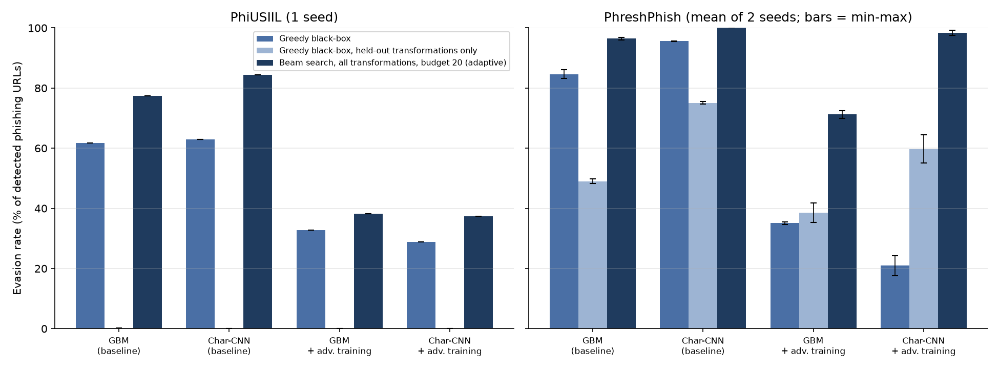

# Editing phishing URLs past URL-only detectors

I trained two phishing URL detectors and then tried to get phishing URLs past
them using only edits a phisher can make to a link they already control:
switching to HTTPS, adding or dropping `www`, moving the page to another path,
adding a harmless query parameter. The registrable domain never changes, so
the attacker doesn't have to buy anything new.

The detectors are a gradient-boosted tree model (GBM) on 30 hand-built URL
features and a small character-level CNN. Both only see the URL string. Every
number below comes from the runs saved in the repo's `results/` folder. They
are single-run (seed 42) point estimates unless I say otherwise; the
[paper](paper.md) has the 95% intervals and the three-seed ranges. Evasion
rates count only the phishing URLs a model caught before the attack, so each
model's denominator is a little different.

## First dataset: high scores for the wrong reason

On the PhiUSIIL dataset both models scored about 0.998 F1. A greedy attack
tries every allowed edit, keeps the one that lowers the phishing score most,
and stops after 10 edits. It got 61.7% (GBM) and 63.0% (CNN) of the phishing
URLs each model had caught past it, usually with a single edit.

The cause was the data. 99.97% of PhiUSIIL's legitimate URLs are bare
`https://www.<domain>` homepages. A one-line rule, "flag anything that isn't a
bare https://www homepage", scores 0.9948 F1. The models had mostly learned
that rule, so making a phishing URL look like a homepage was enough.

## Second dataset: fairer, and the attack got stronger

So I added PhreshPhish, a 2025 dataset (CC BY 4.0) whose legitimate URLs look
like real browsing: 92.5% of them have a path. It also ships a time-based
split, so the test URLs are newer than anything in training. The homepage rule
falls to 0.61 F1 there. PhreshPhish has a smaller quirk of its own: legitimate
URLs almost never carry a query string. That rule alone has 0.997 precision
but catches only 24% of phishing.

Clean scores dropped to 0.929 F1 for the GBM and 0.947 for the CNN, which is
more believable. I expected the attack to get weaker once the obvious shortcut
was gone. It got stronger. The same greedy attack evaded 83.2% of the GBM's
detections and 95.6% of the CNN's. When legitimate URLs have all kinds of
paths, a phishing URL has more ways to look normal, not fewer.

## Adversarial training looked better than it was

Adversarial training here means: attack the model on training URLs, add the
results to the training data labelled as phishing, retrain, and repeat once.
On PhiUSIIL it cut greedy evasion to 32.7% (GBM) and 28.9% (CNN). On
PhreshPhish it cut it to 34.7% and 17.6%. It also cost false positives on
PhreshPhish: the GBM's rate went from 3.1% to 3.9%, and the CNN's from 2.2%
to 4.8%. The GBM's rise showed up on all three seeds; the CNN's only on
seed 42.

That only measures the defense against the attack it was trained on. So I
added two attacks it never saw. One is the greedy attack restricted to a
separate set of edits that training never used: article-style paths, file
extensions, ad-click tracking parameters, a trailing slash, a neutral
subdomain such as `static`, and percent-encoding one letter of the path. The
other is a beam search over all edits with a budget of 20.

Against the adversarially trained CNN, the held-out edits evaded 55.1% and the
beam search 97.6%. For the GBM the figures were 35.2% and 70.0%. The CNN is
the clearest case: it learned to resist particular edits, not the general
idea of dressing a URL up.

## What held up

Models that only look at the registrable domain can't be evaded under these
rules at all, because nothing the attacker changes reaches them, although
wrapping the URL in a link shortener, which is outside our threat model, still
evades the domain-only GBM about 24% of the time. They pay for
it in accuracy: 0.817 and 0.846 F1 on PhreshPhish. When the attacker can only
append a parameter or fragment, which is roughly the position of someone using
a compromised site they don't fully control, evasion stayed at 1.2% or lower in every run.

Models also didn't carry over between datasets. The PhreshPhish-trained GBM
flagged 99.9% of PhiUSIIL's legitimate homepages as phishing (F1 0.571). It
had learned the opposite habit: a bare homepage looked odd to it.

I re-ran everything with two more seeds (42, 43 and 44 on both datasets) and
got the same story. Averaged over the three PhreshPhish runs, greedy evasion
was 84.9% for the GBM and 95.1% for the CNN, with pooled 95% intervals no wider
than ±1.5 points. The adversarially trained CNN moved more between
seeds, from 17.6% to 26.9% under the greedy attack. On PhiUSIIL the baseline
CNN's greedy evasion ranged from 50.6% to 63.0%.

## Round 2: checking my own work

A review pointed out that PhiUSIIL's random split leaks domains: 38.6% of
phishing test URLs (averaged over three seeds) share a registrable domain with a phishing training URL.
I re-split by domain. For the GBM the numbers barely moved (greedy evasion
61.7% vs. 63.5% over three seeds), so the shortcut that makes PhiUSIIL easy
is the homepage format, not the leak.

PhreshPhish's test set is later than its training set, so I broke it down by
month. The GBM caught 95.9% of phishing on held-out training-period data but
58.7% in the first month after training ended, and its false-positive rate
reached 8.4% in December.

Two other checks made the picture worse, not better. Tuning the threshold for
a 0.1% false-positive rate raised greedy evasion of the GBM to 99.2%, because
a stricter threshold is easier to slip under. And an attacker who only sees
"blocked / not blocked" and tries random valid edits still got past about a
quarter of detections within 10 edits.

## What I'd take from this

* A near-perfect benchmark score can come from how the legitimate URLs were
  collected. Try a few one-line rules before trusting the model.
* Test a defense against edits it wasn't trained on and against a stronger
  search, not only a replay of the training attack.
* In a URL-only model, everything the attacker controls is cheap to change.
  What's left is the registrable domain and signals outside the URL.

The limits matter. These are URL-only research models, the rewritten URLs are
checked for syntax and ownership rules but not for whether they'd still serve
the page, and the main attacker is assumed to run their own server and DNS.
Details are in the [paper](paper.md) and the
[threat model](threat-model.md).
